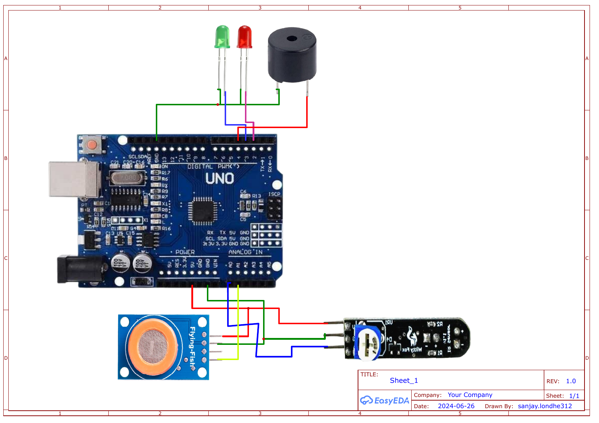
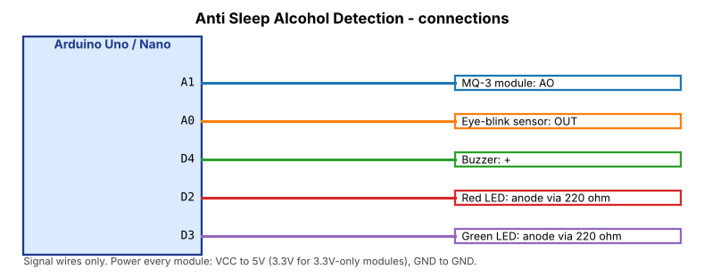

# Anti Sleep Alcohol Detection

> Combines an eye-blink sensor and an alcohol sensor to warn a drowsy or drunk driver.

**Board:** Arduino Uno / Nano (same pin names)

## Components required

- Arduino Uno / Nano
- MQ-3 alcohol sensor
- IR eye-blink sensor
- Buzzer
- Red LED + green LED

## Circuit / wiring

_Circuit diagram drawn in EasyEDA._

| Component | Component pin | Connect to (board pin) |
|---|---|---|
| MQ-3 module | AO | A1 |
| Eye-blink sensor | OUT | A0 |
| Buzzer | + | D4 |
| Red LED | anode via 220 ohm | D2 |
| Green LED | anode via 220 ohm | D3 |

_The pin numbers come straight from the `.ino` code. The connection charts are generated from the same pin list (not a Fritzing drawing). Double-check against your own hardware before powering on._

## Libraries needed

- None (built-in only)

## Code

- `anti-sleep-alcohol-detection.ino`

## Working

1. Every second the Arduino reads the alcohol sensor (A1) and the eye-blink sensor (A0).
2. The eye-blink reading is converted to a 0-100 % ratio.
3. If the ratio is above 20 (drowsy condition in this version), the red LED lights and the buzzer sounds a 1 kHz tone for one second.
4. If the alcohol value is above 500, the buzzer and red LED stay ON; otherwise the green LED is ON.

## Notes

- Wiring diagram (`circuit.png`) was drawn in EasyEDA. The pin table above comes from the code, so follow the table if the picture's LED/buzzer wires are unclear.
- The vehicle version in `eye-blink-sleep-detection` triggers when the ratio is *below* 20 and needs the eyes closed for 3 s. Calibrate this threshold for your own sensor.
