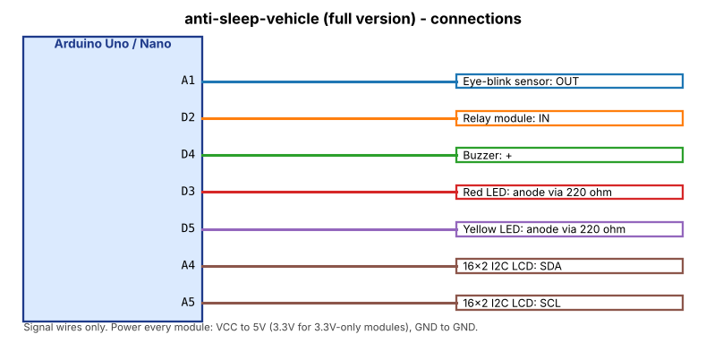
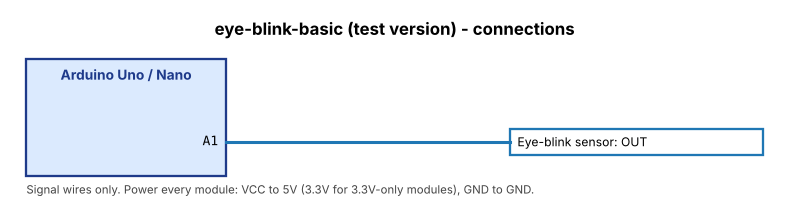

# Eye Blink Sleep Detection

> If the eyes stay closed for 3 seconds the relay cuts the vehicle and a buzzer sounds (basic and full vehicle versions).

**Board:** Arduino Uno / Nano (same pin names)

## Components required

- Arduino Uno / Nano
- IR eye-blink sensor (mounted on spectacles)
- Relay module (vehicle ignition / motor)
- Buzzer
- Red LED, yellow LED
- 16x2 I2C LCD (vehicle version)

## Circuit / wiring

### anti-sleep-vehicle (full version)

| Component | Component pin | Connect to (board pin) |
|---|---|---|
| Eye-blink sensor | OUT | A1 |
| Relay module | IN | D2 |
| Buzzer | + | D4 |
| Red LED | anode via 220 ohm | D3 |
| Yellow LED | anode via 220 ohm | D5 |
| 16x2 I2C LCD | GND | GND |
| 16x2 I2C LCD | VCC | 5V |
| 16x2 I2C LCD | SDA | A4 |
| 16x2 I2C LCD | SCL | A5 |

### eye-blink-basic (test version)

| Component | Component pin | Connect to (board pin) |
|---|---|---|
| Eye-blink sensor | OUT | A1 |
| Eye-blink sensor | VCC | 5V |
| Eye-blink sensor | GND | GND |

_The pin numbers come straight from the `.ino` code. The connection charts are generated from the same pin list (not a Fritzing drawing). Double-check against your own hardware before powering on._

## Libraries needed

- `LiquidCrystal_I2C.h`
- `Wire.h`

## Code

- `eye-blink-basic/eye-blink-basic.ino`
- `anti-sleep-vehicle/anti-sleep-vehicle.ino`

## Working

**Full version (`anti-sleep-vehicle`)**
1. The eye-blink sensor reading (A1) is converted to a 0-100 % ratio and shown on the LCD.
2. Normal state: yellow LED ON, relay ON (vehicle can run), LCD shows *Driver Alert*.
3. If the ratio stays **below 20 % for 3 seconds** (eyes closed), the driver is considered drowsy: relay is switched OFF (vehicle stops), buzzer ON, red LED ON, LCD shows *Driver Drowsy!*.
4. When the eyes open again, the timer resets and the system returns to normal.

**Basic version** only prints the ratio and drowsiness message on the Serial Monitor so you can calibrate the sensor.

## Notes

- Relay logic is written for an active-low relay module; check yours.
- In the full version the relay returns to ON as soon as the driver is alert again.
