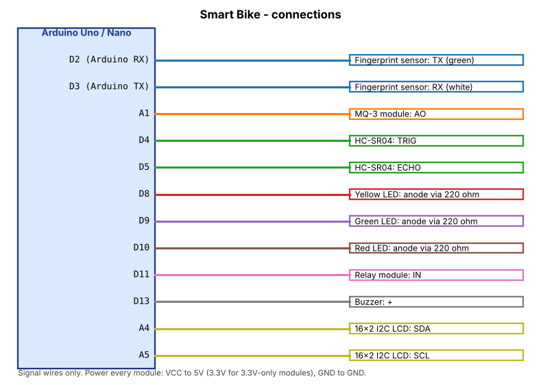

# Smart Bike

> Bike starts only after fingerprint match, no alcohol and a helmet check; relay controls ignition.

**Board:** Arduino Uno / Nano (same pin names)

## Components required

- Arduino Uno / Nano
- R307 / Adafruit-compatible fingerprint sensor
- MQ-3 alcohol sensor
- HC-SR04 ultrasonic sensor (helmet check)
- Relay module (ignition)
- Buzzer, red / green / yellow LEDs
- 16x2 I2C LCD

## Circuit / wiring

| Component | Component pin | Connect to (board pin) |
|---|---|---|
| Fingerprint sensor | TX (green) | D2 (Arduino RX) |
| Fingerprint sensor | RX (white) | D3 (Arduino TX) |
| MQ-3 module | AO | A1 |
| HC-SR04 | TRIG | D4 |
| HC-SR04 | ECHO | D5 |
| Yellow LED | anode via 220 ohm | D8 |
| Green LED | anode via 220 ohm | D9 |
| Red LED | anode via 220 ohm | D10 |
| Relay module | IN | D11 |
| Buzzer | + | D13 |
| 16x2 I2C LCD | GND | GND |
| 16x2 I2C LCD | VCC | 5V |
| 16x2 I2C LCD | SDA | A4 |
| 16x2 I2C LCD | SCL | A5 |

_The pin numbers come straight from the `.ino` code. The connection charts are generated from the same pin list (not a Fritzing drawing). Double-check against your own hardware before powering on._

## Libraries needed

- `Adafruit_Fingerprint.h`
- `LiquidCrystal_I2C.h`
- `SoftwareSerial.h`
- `Wire.h`

## Code

- `smart-bike.ino`

## Working

1. On power-up the LCD shows *Welcome To SD Bike* and checks that the fingerprint module is connected.
2. The MQ-3 sensor is averaged and compared with the threshold (**300**). If alcohol is detected the LCD shows *Driver is Drunk / unable to drive*, the alarm sounds and the relay (ignition) stays OFF.
3. If no alcohol, the system asks the rider to *Place Finger*.
4. An authorised fingerprint passes; an unknown finger shows *Unauthorized*.
5. After authorisation the ultrasonic sensor checks the **helmet** (distance check). No helmet: *Wear Helmet / System Stopped*.
6. Only when all three checks pass does the relay switch ON and the LCD shows *System Started / Authorized*.

## Notes

- Fingerprints must be enrolled first (use the Adafruit `enroll` example).
- In one error message the code prints the text `alcoholValue` instead of the number - a small bug you can fix.
