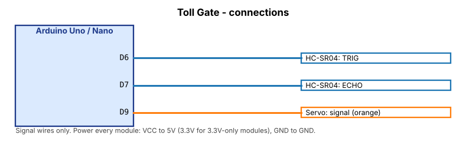

# Toll Gate

> Ultrasonic sensor detects a car within 10 cm and a servo opens the barrier.

**Board:** Arduino Uno / Nano (same pin names)

## Components required

- Arduino Uno / Nano
- HC-SR04 ultrasonic sensor
- SG90 servo motor (barrier arm)

## Circuit / wiring

| Component | Component pin | Connect to (board pin) |
|---|---|---|
| HC-SR04 | VCC | 5V |
| HC-SR04 | GND | GND |
| HC-SR04 | TRIG | D6 |
| HC-SR04 | ECHO | D7 |
| Servo | signal (orange) | D9 |
| Servo | VCC (red) | 5V |
| Servo | GND (brown) | GND |

_The pin numbers come straight from the `.ino` code. The connection charts are generated from the same pin list (not a Fritzing drawing). Double-check against your own hardware before powering on._

## Libraries needed

- `Servo.h`

## Code

- `toll-gate.ino`

## Working

1. The Arduino sends a 10 microsecond pulse on TRIG and measures the echo time.
2. Distance (cm) = time x 0.034 / 2.
3. If a vehicle is **within 10 cm**, the servo moves to **90 degrees** (gate open) and the Serial Monitor prints *Car detected. Gate opened.*
4. Otherwise the servo returns to 0 degrees (gate closed).
5. This repeats every second.

## Notes

- The gate stays closed for up to a second after the car passes; reduce `delay(1000)` for faster response.
