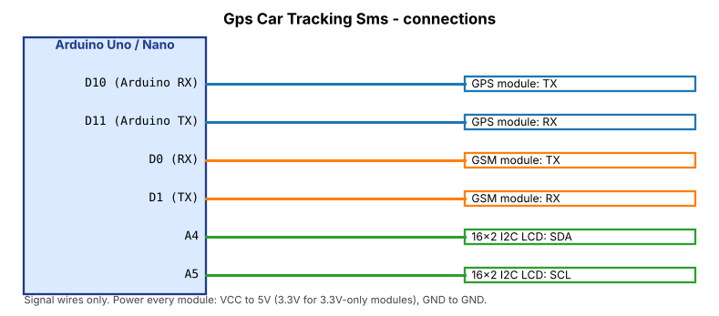

# Gps Car Tracking Sms

> Reads GPS coordinates and sends them by SMS through a GSM module.

**Board:** Arduino Uno / Nano (same pin names)

## Components required

- Arduino Uno / Nano
- NEO-6M GPS module
- SIM800 / SIM900 GSM module
- 16x2 I2C LCD

## Circuit / wiring

| Component | Component pin | Connect to (board pin) |
|---|---|---|
| GPS module | TX | D10 (Arduino RX) |
| GPS module | RX | D11 (Arduino TX) |
| GSM module | TX | D0 (RX) |
| GSM module | RX | D1 (TX) |
| 16x2 I2C LCD | GND | GND |
| 16x2 I2C LCD | VCC | 5V |
| 16x2 I2C LCD | SDA | A4 |
| 16x2 I2C LCD | SCL | A5 |

_The pin numbers come straight from the `.ino` code. The connection charts are generated from the same pin list (not a Fritzing drawing). Double-check against your own hardware before powering on._

## Libraries needed

- `LiquidCrystal_I2C.h`
- `SoftwareSerial.h`
- `TinyGPS++.h`
- `Wire.h`

## Code

- `gps-car-tracking-sms.ino`

## Working

1. The LCD shows the start-up steps: GPS initialising, GPS range found, GSM module found, network found.
2. The system then waits for an SMS.
3. When the SMS text **Track Vehicle** is received, the Arduino reads the current GPS position.
4. It replies by SMS: *Vehicle Tracking Alert: Your Vehicle Current Location is:* followed by a **Google Maps link** with the latitude and longitude.
5. The LCD shows *Message Sent* and returns to *System Ready*.

## Notes

- The GSM module uses the hardware serial pins (0 and 1), so disconnect it while uploading code.
- Replace the phone-number placeholder in the code.
