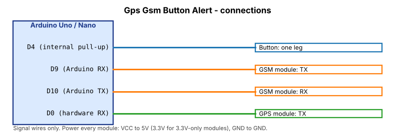

# Gps Gsm Button Alert

> Button press sends an SMS containing the current GPS location.

**Board:** Arduino Uno / Nano (same pin names)

## Components required

- Arduino Uno / Nano
- NEO-6M GPS module
- SIM800 / SIM900 GSM module
- Push button

## Circuit / wiring

| Component | Component pin | Connect to (board pin) |
|---|---|---|
| Button | one leg | D4 (internal pull-up) |
| Button | other leg | GND |
| GSM module | TX | D9 (Arduino RX) |
| GSM module | RX | D10 (Arduino TX) |
| GPS module | TX | D0 (hardware RX) |

_The pin numbers come straight from the `.ino` code. The connection charts are generated from the same pin list (not a Fritzing drawing). Double-check against your own hardware before powering on._

## Libraries needed

- `SoftwareSerial.h`
- `TinyGPS.h`

## Code

- `gps-gsm-button-alert.ino`

## Working

1. GPS NMEA data comes in on the hardware serial port and is decoded with `TinyGPS`.
2. When the button is pressed (D4 LOW), the Arduino reads the latest latitude/longitude.
3. If the GPS data is valid, the GSM module sends an SMS containing the location. If not, the Serial Monitor shows *Invalid GPS data. SMS not sent.*

## Notes

- Disconnect the GPS TX wire from D0 while uploading code.
