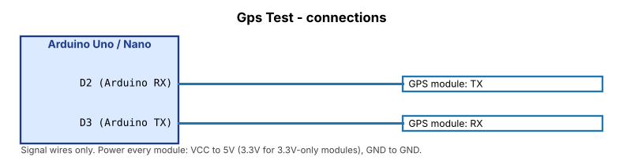

# Gps Test

> Simple GPS module test that prints coordinates on the Serial Monitor.

**Board:** Arduino Uno / Nano (same pin names)

## Components required

- Arduino Uno / Nano
- NEO-6M GPS module

## Circuit / wiring

| Component | Component pin | Connect to (board pin) |
|---|---|---|
| GPS module | VCC | 5V (or 3.3V) |
| GPS module | GND | GND |
| GPS module | TX | D2 (Arduino RX) |
| GPS module | RX | D3 (Arduino TX) |

_The pin numbers come straight from the `.ino` code. The connection charts are generated from the same pin list (not a Fritzing drawing). Double-check against your own hardware before powering on._

## Libraries needed

- `SoftwareSerial.h`
- `TinyGPS++.h`

## Code

- `gps-test.ino`

## Working

Uses `TinyGPS++` to read NMEA data from the GPS module on D2/D3. Latitude, longitude and satellite data are printed on the Serial Monitor at 9600 baud. Take the module outdoors and wait 1-2 minutes for the first fix.

