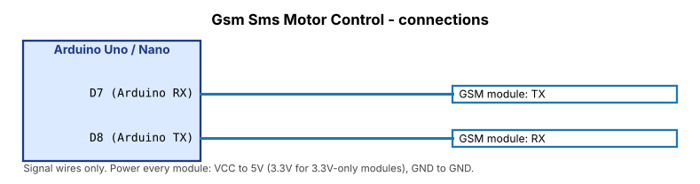

# Gsm Sms Motor Control

> Turn a motor on/off by sending SMS commands to a GSM module.

**Board:** Arduino Uno / Nano (same pin names)

## Components required

- Arduino Uno / Nano
- SIM800 / SIM900 GSM module
- Relay module + motor (add yourself)

## Circuit / wiring

| Component | Component pin | Connect to (board pin) |
|---|---|---|
| GSM module | TX | D7 (Arduino RX) |
| GSM module | RX | D8 (Arduino TX) |

_The pin numbers come straight from the `.ino` code. The connection charts are generated from the same pin list (not a Fritzing drawing). Double-check against your own hardware before powering on._

## Libraries needed

- `SoftwareSerial.h`

## Code

- `gsm-sms-motor-control.ino`

## Working

1. The GSM module is initialised (AT commands, text mode, new-SMS indication).
2. The Arduino reads each incoming SMS.
3. Text **ON** gives the reply *Motor turned ON*; text **OFF** gives *Motor turned OFF*.

## Notes

- Status: the code only sends the confirmation SMS. The lines that actually switch the motor are placeholders (`// Code to turn motor on/off`). Add a relay pin and `digitalWrite()` there.
