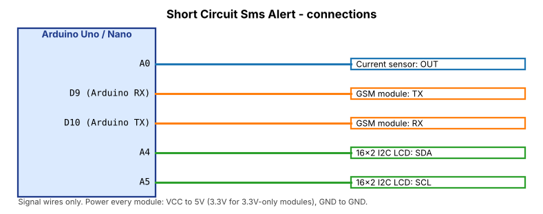

# Short Circuit Sms Alert

> Current sensor detects a short circuit, shows it on the LCD and sends an SMS.

**Board:** Arduino Uno / Nano (same pin names)

## Components required

- Arduino Uno / Nano
- Current sensor module (ACS712 type)
- SIM800 / SIM900 GSM module
- 16x2 I2C LCD

## Circuit / wiring

| Component | Component pin | Connect to (board pin) |
|---|---|---|
| Current sensor | OUT | A0 |
| GSM module | TX | D9 (Arduino RX) |
| GSM module | RX | D10 (Arduino TX) |
| 16x2 I2C LCD | GND | GND |
| 16x2 I2C LCD | VCC | 5V |
| 16x2 I2C LCD | SDA | A4 |
| 16x2 I2C LCD | SCL | A5 |

_The pin numbers come straight from the `.ino` code. The connection charts are generated from the same pin list (not a Fritzing drawing). Double-check against your own hardware before powering on._

## Libraries needed

- `LiquidCrystal_I2C.h`
- `SoftwareSerial.h`
- `Wire.h`

## Code

- `short-circuit-sms-alert.ino`

## Working

1. The sensor output on A0 is converted to a voltage (0-5 V).
2. The LCD shows `Current: <voltage>`.
3. If the voltage reaches **2.0 V** (short-circuit threshold), the LCD shows *Short Circuit!* and the GSM module sends the SMS *Short Circuit Detected!*.
4. After sending, the system waits 10 seconds before checking again.

## Notes

- Tune `shortCircuitThreshold` for your sensor and load.
- Mains wiring is dangerous; test with low-voltage loads only.
