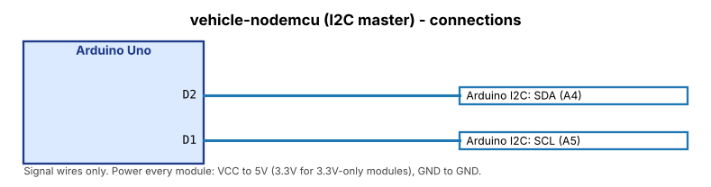

# Vehicle Tracking Accident Alert

> GPS speed/location plus accelerometer; Arduino sends data to NodeMCU (Blynk map) and SMS alerts for over-speed or accident. Group project - add team credits.

**Board:** Arduino Uno (vehicle unit) + NodeMCU ESP8266 (Blynk gateway)

## Components required

- Arduino Uno
- NodeMCU ESP8266
- NEO-6M GPS module
- SIM800 / SIM900 GSM module
- ADXL335 accelerometer
- 16x2 LCD (4-bit, not I2C)
- Blynk app (map, speed, LED widgets)

## Circuit / wiring

### vehicle-arduino

| Component | Component pin | Connect to (board pin) |
|---|---|---|
| GPS module | TX | D3 |
| GPS module | RX | D4 |
| GSM module | TX | D5 |
| GSM module | RX | D6 |
| ADXL335 | X-OUT | A0 |
| ADXL335 | Y-OUT | A1 |
| LCD | RS | D8 |
| LCD | EN | D9 |
| LCD | D4 | D10 |
| LCD | D5 | D11 |
| LCD | D6 | D12 |
| LCD | D7 | D13 |
| I2C to NodeMCU | SDA | A4 |
| I2C to NodeMCU | SCL | A5 |

### vehicle-nodemcu (I2C master)

| Component | Component pin | Connect to (board pin) |
|---|---|---|
| Arduino I2C | SDA (A4) | D2 |
| Arduino I2C | SCL (A5) | D1 |
| Arduino | GND | GND (common ground) |

_The pin numbers come straight from the `.ino` code. The connection charts are generated from the same pin list (not a Fritzing drawing). Double-check against your own hardware before powering on._

## Libraries needed

- `BlynkSimpleEsp8266.h`
- `ESP8266WiFi.h`
- `LiquidCrystal.h`
- `SoftwareSerial.h`
- `TinyGPS.h`
- `Wire.h`

## Code

- `vehicle-arduino/vehicle-arduino.ino`
- `vehicle-nodemcu/vehicle-nodemcu.ino`

## Working

1. The Arduino reads GPS latitude, longitude and speed and the accelerometer X/Y values, and shows them on the LCD.
2. If speed reaches **50 km/h or more**, the GSM module sends *Your vehicle crossed the speed limit* by SMS.
3. If the X/Y readings go outside the safe range (vehicle tilt or crash), an **Accident Alert** SMS is sent.
4. The Arduino acts as an I2C slave (address 2). The NodeMCU requests a 30-character packet containing latitude, longitude, X, Y, count and speed.
5. The NodeMCU shows the position on the **Blynk map**, speed and count on gauges, and blinks an alert LED when X/Y are outside 270-390.

## Demo video / photos

_Add a YouTube or Google Drive link here, and photos of the finished project._

## Notes

- Circuit diagram: see `circuit-diagram.pdf` in this folder.
- Original code from a group project (the LCD welcome text names a course and team). Confirm you have permission to publish it, or remove those strings and credit the authors properly.
