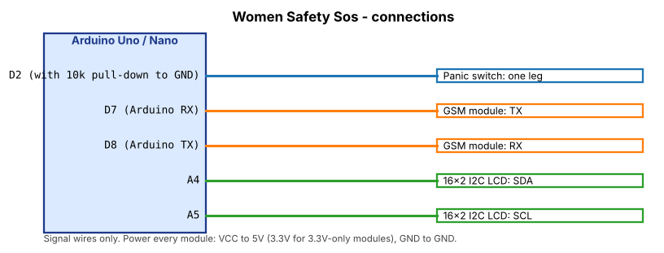

# Women Safety Sos

> Panic switch sends a help SMS with location and places a call.

**Board:** Arduino Uno / Nano (same pin names)

## Components required

- Arduino Uno / Nano
- SIM800 / SIM900 GSM module
- Push button (panic switch)
- 10k ohm pull-down resistor
- 16x2 I2C LCD

## Circuit / wiring

| Component | Component pin | Connect to (board pin) |
|---|---|---|
| Panic switch | one leg | D2 (with 10k pull-down to GND) |
| Panic switch | other leg | 5V |
| GSM module | TX | D7 (Arduino RX) |
| GSM module | RX | D8 (Arduino TX) |
| 16x2 I2C LCD | GND | GND |
| 16x2 I2C LCD | VCC | 5V |
| 16x2 I2C LCD | SDA | A4 |
| 16x2 I2C LCD | SCL | A5 |

_The pin numbers come straight from the `.ino` code. The connection charts are generated from the same pin list (not a Fritzing drawing). Double-check against your own hardware before powering on._

## Libraries needed

- `LiquidCrystal_I2C.h`
- `SoftwareSerial.h`
- `Wire.h`

## Code

- `women-safety-sos.ino`

## Working

1. The LCD shows *hello user* while the system waits.
2. When the switch is pressed (D2 goes HIGH), `sendMessage()` runs: the GSM module sends the SMS *please help me!! location:* with coordinates, and the LCD shows the latitude and longitude.
3. `makeCall()` then dials the saved emergency number.

## Notes

- The coordinates in this version are typed into the code. Combine with the GPS sketches for live location.
- Replace the phone-number placeholders before use.
