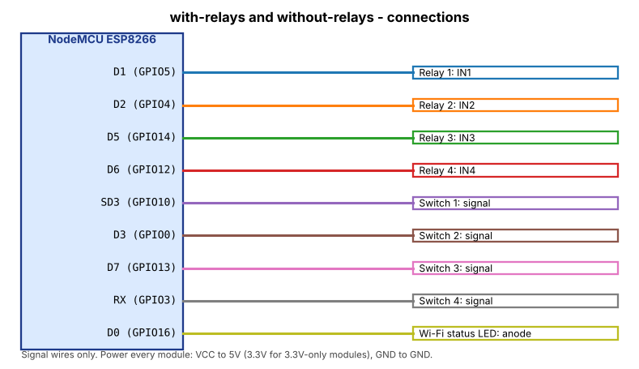
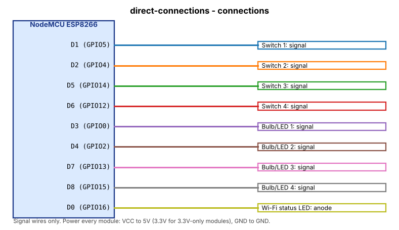

# Alexa Google 4Relay Switch

> NodeMCU controls 4 relays by Alexa / Google Assistant using Sinric Pro, with manual switches.

**Board:** NodeMCU ESP8266

## Components required

- NodeMCU ESP8266
- 4-channel relay module (or 4 LEDs/bulbs for the direct version)
- 4 push buttons / switches for manual control
- Wi-Fi LED
- Sinric Pro account + Alexa or Google Home app

## Circuit / wiring

### with-relays and without-relays

| Component | Component pin | Connect to (board pin) |
|---|---|---|
| Relay 1 | IN1 | D1 (GPIO5) |
| Relay 2 | IN2 | D2 (GPIO4) |
| Relay 3 | IN3 | D5 (GPIO14) |
| Relay 4 | IN4 | D6 (GPIO12) |
| Switch 1 | signal | SD3 (GPIO10) |
| Switch 2 | signal | D3 (GPIO0) |
| Switch 3 | signal | D7 (GPIO13) |
| Switch 4 | signal | RX (GPIO3) |
| Wi-Fi status LED | anode | D0 (GPIO16) |

### direct-connections

| Component | Component pin | Connect to (board pin) |
|---|---|---|
| Switch 1 | signal | D1 (GPIO5) |
| Switch 2 | signal | D2 (GPIO4) |
| Switch 3 | signal | D5 (GPIO14) |
| Switch 4 | signal | D6 (GPIO12) |
| Bulb/LED 1 | signal | D3 (GPIO0) |
| Bulb/LED 2 | signal | D4 (GPIO2) |
| Bulb/LED 3 | signal | D7 (GPIO13) |
| Bulb/LED 4 | signal | D8 (GPIO15) |
| Wi-Fi status LED | anode | D0 (GPIO16) |

_The pin numbers come straight from the `.ino` code. The connection charts are generated from the same pin list (not a Fritzing drawing). Double-check against your own hardware before powering on._

## Libraries needed

- `Arduino.h`
- `ESP8266WiFi.h`
- `SinricPro.h`
- `SinricProSwitch.h`
- `map`

## Code

- `with-relays/with-relays.ino`
- `without-relays/without-relays.ino`
- `direct-connections/direct-connections.ino`

## Working

1. Create 4 *Switch* devices in the Sinric Pro dashboard and copy the App Key, App Secret and Device IDs into the code.
2. Link Sinric Pro to Alexa or Google Home and discover the devices.
3. Say *Alexa, turn on bedroom light*. Sinric Pro sends the command to the NodeMCU over Wi-Fi, which switches the matching relay.
4. The manual switches toggle the same relay, and the state is reported back to Sinric Pro so the app stays in sync.
5. The Wi-Fi LED shows the connection status.

## Notes

- Pins use GPIO numbers; the D-labels shown are for NodeMCU.
- GPIO3 (RX) and GPIO10 (SD3) are special pins - they work, but avoid them when you design your own board.
