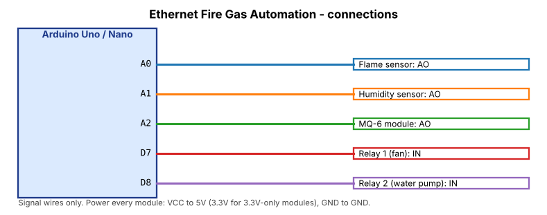

# Ethernet Fire Gas Automation

> Flame, humidity and MQ-6 gas readings in Blynk over Ethernet; fan and pump switched from the app.

**Board:** Arduino Uno / Nano (same pin names) + Ethernet shield (W5100)

## Components required

- Arduino Uno + Ethernet shield
- Flame sensor module
- Humidity sensor module
- MQ-6 gas sensor
- 2-channel relay module
- Exhaust fan and water pump
- Blynk app (template *Ethernet*)

## Circuit / wiring

| Component | Component pin | Connect to (board pin) |
|---|---|---|
| Flame sensor | AO | A0 |
| Humidity sensor | AO | A1 |
| MQ-6 module | AO | A2 |
| Relay 1 (fan) | IN | D7 |
| Relay 2 (water pump) | IN | D8 |

_The pin numbers come straight from the `.ino` code. The connection charts are generated from the same pin list (not a Fritzing drawing). Double-check against your own hardware before powering on._

## Libraries needed

- `BlynkSimpleEthernet.h`
- `Ethernet.h`
- `SPI.h`

## Code

- `ethernet-fire-gas-automation.ino`

## Working

1. The Arduino connects to Blynk over Ethernet.
2. It reads the flame (A0), humidity (A1) and gas (A2) sensors and sends them to Blynk datastreams **V0, V1, V3**.
3. From the Blynk app the user can switch the **fan (V4)** and the **water pump (V5)** using the relays.
4. The values are also printed on the Serial Monitor.

## Notes

- The Ethernet shield uses D10-D13 internally, so those pins are not free.
