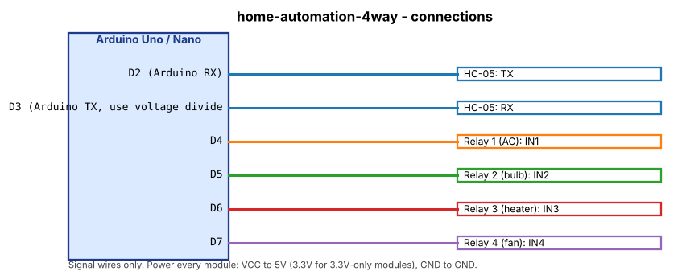
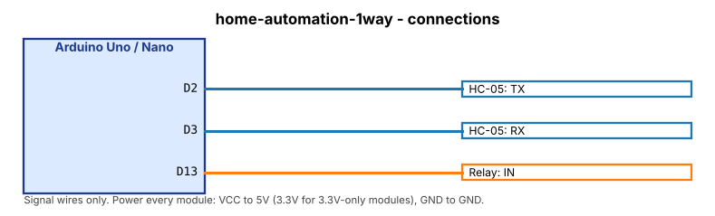

# Home Automation Bluetooth

> Control AC, bulb, heater and fan through a 4-channel relay using Bluetooth/serial commands (4-way and 1-way versions).

**Board:** Arduino Uno / Nano (same pin names)

## Components required

- Arduino Uno / Nano
- HC-05 Bluetooth module
- 4-channel relay module
- AC, bulb, heater and fan (appliances - take care with mains voltage)
- Android Bluetooth terminal app

## Circuit / wiring

### home-automation-4way

| Component | Component pin | Connect to (board pin) |
|---|---|---|
| HC-05 | TX | D2 (Arduino RX) |
| HC-05 | RX | D3 (Arduino TX, use voltage divider) |
| Relay 1 (AC) | IN1 | D4 |
| Relay 2 (bulb) | IN2 | D5 |
| Relay 3 (heater) | IN3 | D6 |
| Relay 4 (fan) | IN4 | D7 |

### home-automation-1way

| Component | Component pin | Connect to (board pin) |
|---|---|---|
| HC-05 | TX | D2 |
| HC-05 | RX | D3 |
| Relay | IN | D13 |

_The pin numbers come straight from the `.ino` code. The connection charts are generated from the same pin list (not a Fritzing drawing). Double-check against your own hardware before powering on._

## Libraries needed

- `SoftwareSerial.h`

## Code

- `home-automation-4way/home-automation-4way.ino`
- `home-automation-1way/home-automation-1way.ino`

## Working

1. Pair the phone with the HC-05 and open a Bluetooth terminal app.
2. The app sends one command character; the Arduino reads it with `SoftwareSerial`.
3. Commands: **a / b** = AC ON / OFF, **c / d** = bulb ON / OFF, **e / f** = heater ON / OFF, **g / h** = fan ON / OFF. The Arduino prints a message such as *AC turned ON* for each one.
4. The 1-way version controls a single relay on pin 13 the same way.

## Demo video / photos

_Add a YouTube or Google Drive link here, and photos of the finished project._

## Notes

- Set your Bluetooth app buttons to send the letters a-h.
- Mains voltage can kill. Use an enclosed relay board and keep AC wiring away from the low-voltage side.
