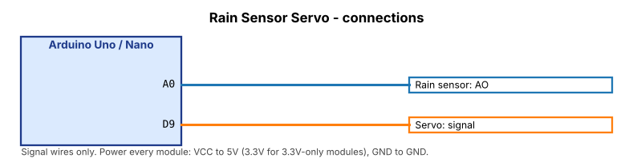

# Rain Sensor Servo

> Servo moves when the rain sensor detects rain and returns when it stops.

**Board:** Arduino Uno / Nano (same pin names)

## Components required

- Arduino Uno / Nano
- Rain sensor module
- SG90 servo (cover / wiper)

## Circuit / wiring

| Component | Component pin | Connect to (board pin) |
|---|---|---|
| Rain sensor | AO | A0 |
| Rain sensor | VCC | 5V |
| Rain sensor | GND | GND |
| Servo | signal | D9 |
| Servo | VCC | 5V |
| Servo | GND | GND |

_The pin numbers come straight from the `.ino` code. The connection charts are generated from the same pin list (not a Fritzing drawing). Double-check against your own hardware before powering on._

## Libraries needed

- `Servo.h`

## Code

- `rain-sensor-servo.ino`

## Working

1. The rain sensor reading (0-1023) is mapped to 255-0 so that wetter means higher.
2. If the value is **above 170** (rain), the servo sweeps from 0 to 90 degrees; the sweep stops early if the rain stops.
3. When dry, the servo goes back to 0 degrees.

