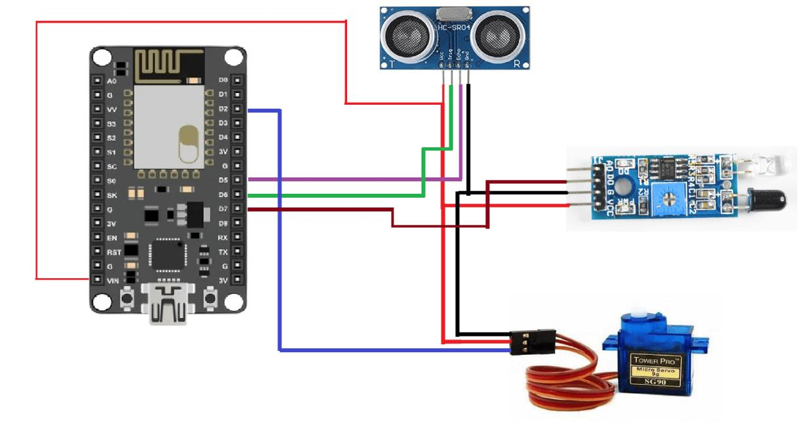
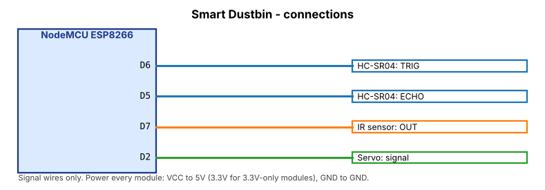

# Smart Dustbin

> IR sensor opens the lid with a servo; ultrasonic sensor reports bin fill level to Blynk.

**Board:** NodeMCU ESP8266

## Components required

- NodeMCU ESP8266
- HC-SR04 ultrasonic sensor (fill level)
- IR obstacle sensor (hand detection)
- SG90 servo (lid)
- Blynk app (template *Smart trash can*)

## Circuit / wiring

_Circuit diagram (from the project report)._

| Component | Component pin | Connect to (board pin) |
|---|---|---|
| HC-SR04 | VCC | Vin (5V) |
| HC-SR04 | GND | GND |
| HC-SR04 | TRIG | D6 |
| HC-SR04 | ECHO | D5 |
| IR sensor | OUT | D7 |
| IR sensor | VCC | 3V3 |
| IR sensor | GND | GND |
| Servo | signal | D2 |
| Servo | VCC | Vin (5V) |
| Servo | GND | GND |

_The pin numbers come straight from the `.ino` code. The connection charts are generated from the same pin list (not a Fritzing drawing). Double-check against your own hardware before powering on._

## Libraries needed

- `BlynkSimpleEsp8266.h`
- `ESP8266WiFi.h`
- `Servo.h`

## Code

- `smart-bin/smart-bin.ino`
- `smart-bin-realtime-ir/smart-bin-realtime-ir.ino`

## Working

1. The NodeMCU connects to Wi-Fi and Blynk.
2. When the IR sensor detects a hand or person (D7 HIGH), the servo turns to **180 degrees** and the lid opens. It closes (0 degrees) when the hand leaves.
3. The ultrasonic sensor on top of the lid measures the distance to the garbage. The code maps distance 18 cm to 0 % and 0 cm to 100 %.
4. Blynk shows **V0 = distance (cm)**, **V1 = bin fill %** and **V2 = lid status**.
5. `smart-bin-realtime-ir` keeps updating the level while the lid is open; `smart-bin` opens the lid for a fixed time.

## Demo video / photos

_Add a YouTube or Google Drive link here, and photos of the finished project._

## Notes

- `circuit.png` is the diagram from the project report.
