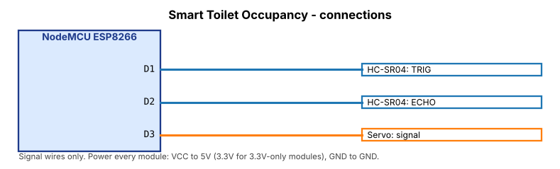

# Smart Toilet Occupancy

> Ultrasonic sensor detects presence, moves a servo and reports Occupied/Unoccupied to Blynk.

**Board:** NodeMCU ESP8266

## Components required

- NodeMCU ESP8266
- HC-SR04 ultrasonic sensor
- SG90 servo (door indicator)
- Blynk app (template *SmartToilet*)

## Circuit / wiring

| Component | Component pin | Connect to (board pin) |
|---|---|---|
| HC-SR04 | TRIG | D1 |
| HC-SR04 | ECHO | D2 |
| Servo | signal | D3 |
| Servo | VCC | Vin (5V) |
| Servo | GND | GND |
| HC-SR04 | VCC | Vin (5V) |
| HC-SR04 | GND | GND |

_The pin numbers come straight from the `.ino` code. The connection charts are generated from the same pin list (not a Fritzing drawing). Double-check against your own hardware before powering on._

## Libraries needed

- `BlynkSimpleEsp8266.h`
- `ESP8266WiFi.h`
- `Servo.h`

## Code

- `smart-toilet-occupancy.ino`

## Working

1. The ultrasonic sensor continuously measures distance.
2. If a person is **closer than 50 cm**, the room is *Occupied*: servo moves to 90 degrees.
3. Otherwise it is *Unoccupied* and the servo returns to 0 degrees.
4. The status text is sent to Blynk on **V0**, so anyone can check availability remotely.

## Notes

- D0 is set as an output for an optional LED (not used in the loop).
