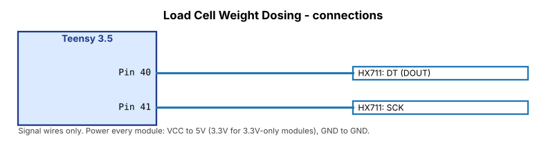

# Load Cell Weight Dosing

> HX711 load cell weighing with serial commands: zero, set <kg>, reset (plus calibration sketch).

**Board:** Teensy 3.5 (pin numbers 40/41 are in the code comment; also fit an Arduino Mega)

## Components required

- Teensy 3.5 or Arduino Mega
- Load cell + HX711 amplifier
- Flask / container on the weighing platform
- USB cable to the PC

## Circuit / wiring

| Component | Component pin | Connect to (board pin) |
|---|---|---|
| HX711 | DT (DOUT) | Pin 40 |
| HX711 | SCK | Pin 41 |
| HX711 | VCC | 3.3V / 5V |
| HX711 | GND | GND |

_The pin numbers come straight from the `.ino` code. The connection charts are generated from the same pin list (not a Fritzing drawing). Double-check against your own hardware before powering on._

## Libraries needed

- `HX711.h`

## Code

- `load-cell/load-cell.ino`
- `load-cell-calibration/load-cell-calibration.ino`

## Working

1. Open the Serial Monitor. The system prints *Weight System is ready* and the weight every 300 ms: `Weight: x.xx kg | Target: y.yy kg`.
2. Type **zero** to tare (remove the empty flask weight).
3. Type **set 2.5** to set a target weight of 2.5 kg.
4. Type **reset** to clear the tare and target.
5. The calibration sketch (`load-cell-calibration`) is used first to find the calibration factor for your load cell.

## Notes

- On an Arduino Uno use any two free digital pins and change the numbers in the code.
