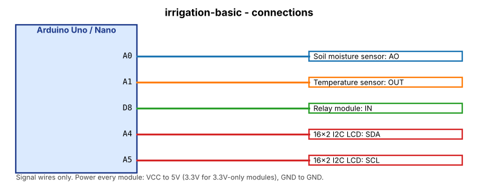
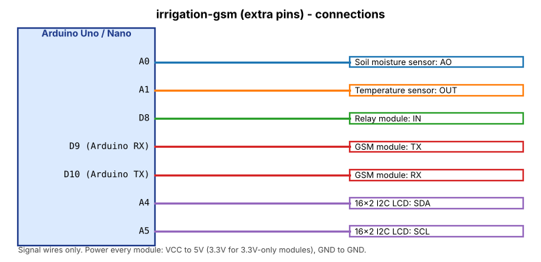

# Smart Irrigation

> Soil moisture and temperature control a pump relay; GSM version also sends SMS.

**Board:** Arduino Uno / Nano (same pin names)

## Components required

- Arduino Uno / Nano
- Soil moisture sensor
- Temperature sensor (LM35 type)
- Relay module + water pump
- 16x2 I2C LCD
- SIM800 GSM module (GSM version)

## Circuit / wiring

### irrigation-basic

| Component | Component pin | Connect to (board pin) |
|---|---|---|
| Soil moisture sensor | AO | A0 |
| Temperature sensor | OUT | A1 |
| Relay module | IN | D8 |
| 16x2 I2C LCD | GND | GND |
| 16x2 I2C LCD | VCC | 5V |
| 16x2 I2C LCD | SDA | A4 |
| 16x2 I2C LCD | SCL | A5 |

### irrigation-gsm (extra pins)

| Component | Component pin | Connect to (board pin) |
|---|---|---|
| Soil moisture sensor | AO | A0 |
| Temperature sensor | OUT | A1 |
| Relay module | IN | D8 |
| GSM module | TX | D9 (Arduino RX) |
| GSM module | RX | D10 (Arduino TX) |
| 16x2 I2C LCD | GND | GND |
| 16x2 I2C LCD | VCC | 5V |
| 16x2 I2C LCD | SDA | A4 |
| 16x2 I2C LCD | SCL | A5 |

_The pin numbers come straight from the `.ino` code. The connection charts are generated from the same pin list (not a Fritzing drawing). Double-check against your own hardware before powering on._

## Libraries needed

- `LiquidCrystal_I2C.h`
- `SoftwareSerial.h`
- `Wire.h`

## Code

- `irrigation-basic/irrigation-basic.ino`
- `irrigation-gsm/irrigation-gsm.ino`

## Working

1. The Arduino reads soil moisture (A0) and temperature (A1) and shows them on the LCD.
2. If the moisture value is **below 300** (dry soil) the relay turns the pump ON and the LCD shows *Pump: ON*.
3. When the soil is wet again the pump turns OFF.
4. The GSM version also sends an SMS such as *Soil is dry, watering the plants* and one at start-up.

## Demo video / photos

_Add a YouTube or Google Drive link here, and photos of the finished project._

## Notes

- Calibrate the dry/wet threshold with your soil sensor.
- Replace the phone-number placeholder in the GSM version.
