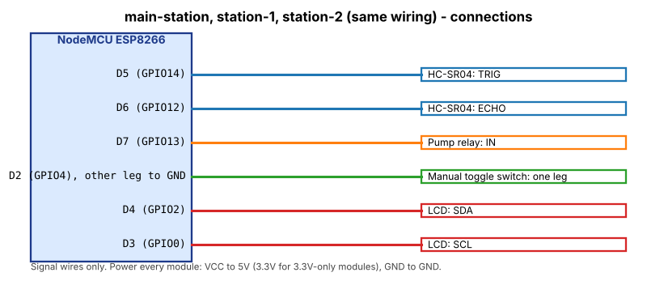
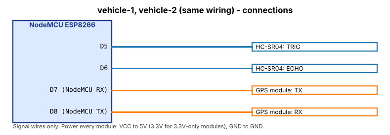

# Water Management

> Multi-node Blynk system: three tank stations with pump control and two GPS-enabled water vehicles.

**Board:** NodeMCU ESP8266 (5 boards: 3 stations and 2 vehicles)

## Components required

- 5 x NodeMCU ESP8266
- 3 x HC-SR04 (tank level at stations) + 2 x HC-SR04 (vehicle tanks)
- 3 x relay module + small water pumps
- 3 x manual toggle switch
- 3 x 16x2 I2C LCD
- 2 x NEO-6M GPS module (vehicles)
- Blynk app (template *Water Management*)

## Circuit / wiring

### main-station, station-1, station-2 (same wiring)

| Component | Component pin | Connect to (board pin) |
|---|---|---|
| HC-SR04 | TRIG | D5 (GPIO14) |
| HC-SR04 | ECHO | D6 (GPIO12) |
| Pump relay | IN | D7 (GPIO13) |
| Manual toggle switch | one leg | D2 (GPIO4), other leg to GND |
| LCD | SDA | D4 (GPIO2) |
| LCD | SCL | D3 (GPIO0) |
| LCD | VCC / GND | Vin (5V) / GND |

### vehicle-1, vehicle-2 (same wiring)

| Component | Component pin | Connect to (board pin) |
|---|---|---|
| HC-SR04 | TRIG | D5 |
| HC-SR04 | ECHO | D6 |
| GPS module | TX | D7 (NodeMCU RX) |
| GPS module | RX | D8 (NodeMCU TX) |

_The pin numbers come straight from the `.ino` code. The connection charts are generated from the same pin list (not a Fritzing drawing). Double-check against your own hardware before powering on._

## Libraries needed

- `BlynkSimpleEsp8266.h`
- `ESP8266WiFi.h`
- `LiquidCrystal_I2C.h`
- `NewPing.h`
- `SoftwareSerial.h`
- `TinyGPS++.h`
- `Wire.h`

## Code

- `main-station/main-station.ino`
- `station-1/station-1.ino`
- `station-2/station-2.ino`
- `vehicle-1/vehicle-1.ino`
- `vehicle-2/vehicle-2.ino`

## Working

**Stations (main-station, station-1, station-2)**
1. The ultrasonic sensor measures the water distance. The code converts 12 cm = 100 % full and 1 cm = empty. A bad reading shows *Sensor Error* and keeps the pump OFF.
2. The LCD shows `Water: xx %` and the pump state.
3. The pump relay can be switched ON from the **manual toggle switch** or from **Blynk** (Main station: V3, Station-1: V1).
4. The level is sent to Blynk only when it changes (Main: V2, Station-1: V0) and an alarm indicator uses V6.

**Vehicles (vehicle-1, vehicle-2)**
1. Every 3 seconds the tank level (9 cm = 100 %) is sent to Blynk **V11**.
2. GPS latitude/longitude go to **V7 / V8** when the position changes by more than about 11 m.
3. This lets you see where each water carrier is and how much water it holds.

## Demo video / photos

simulation video is attached.

## Notes

- The I2C LCD uses `Wire.begin(2, 0)`: SDA = GPIO2 (D4), SCL = GPIO0 (D3). The code comment says D2/D1, but the call is what counts.
- Each node must use its own Blynk device or token if you want separate dashboards.
