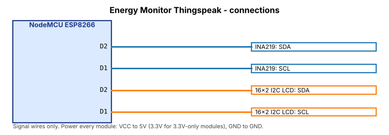

# Energy Monitor Thingspeak

> INA219 measures voltage, current and power, shows them on LCD and uploads to ThingSpeak.

**Board:** NodeMCU ESP8266

## Components required

- NodeMCU ESP8266
- INA219 current/voltage sensor
- 16x2 I2C LCD
- ThingSpeak account (channel with 3 fields)

## Circuit / wiring

| Component | Component pin | Connect to (board pin) |
|---|---|---|
| INA219 | VCC | 3V3 |
| INA219 | GND | GND |
| INA219 | SDA | D2 |
| INA219 | SCL | D1 |
| INA219 | VIN+ / VIN- | in series with the load |
| 16x2 I2C LCD | GND | GND |
| 16x2 I2C LCD | VCC | Vin (5V) |
| 16x2 I2C LCD | SDA | D2 |
| 16x2 I2C LCD | SCL | D1 |

_The pin numbers come straight from the `.ino` code. The connection charts are generated from the same pin list (not a Fritzing drawing). Double-check against your own hardware before powering on._

## Libraries needed

- `Adafruit_INA219.h`
- `ESP8266WiFi.h`
- `LiquidCrystal_I2C.h`
- `ThingSpeak.h`
- `Wire.h`

## Code

- `energy-monitor-thingspeak.ino`

## Working

1. The INA219 measures the bus voltage, current (mA) and power (mW) of the load.
2. The LCD shows the values, with the title *IoT Based Energy Monitoring System*.
3. The NodeMCU connects to Wi-Fi and uploads the values to ThingSpeak: **Field 1 = voltage, Field 2 = current, Field 3 = power**.
4. If the INA219 is not found, the LCD shows *FAILED TO FIND INA219 MODULE*.

