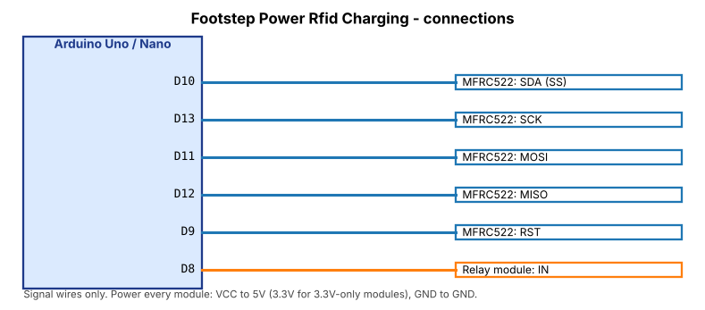

# Footstep Power Rfid Charging

> Footstep-generated power charges a power bank only when an authorised RFID card is scanned.

**Board:** Arduino Uno / Nano (same pin names)

## Components required

- Arduino Uno / Nano
- MFRC522 RFID reader + tags
- Relay module
- Footstep power-generation unit (piezo/dynamo) + power bank

## Circuit / wiring

| Component | Component pin | Connect to (board pin) |
|---|---|---|
| MFRC522 | SDA (SS) | D10 |
| MFRC522 | SCK | D13 |
| MFRC522 | MOSI | D11 |
| MFRC522 | MISO | D12 |
| MFRC522 | RST | D9 |
| MFRC522 | 3.3V | 3.3V |
| MFRC522 | GND | GND |
| Relay module | IN | D8 |

_The pin numbers come straight from the `.ino` code. The connection charts are generated from the same pin list (not a Fritzing drawing). Double-check against your own hardware before powering on._

## Libraries needed

- `MFRC522.h`
- `SPI.h`

## Code

- `footstep-power-rfid-charging.ino`

## Working

1. Footsteps generate power that is stored for charging a power bank through the relay.
2. The user touches an RFID card. The UID is compared with a list of authorised UIDs in the code.
3. **Authorised card:** *User authorized. Charging started.* The relay turns ON.
4. **Unknown card:** *Unauthorized access. Charging not allowed.* The relay stays OFF.

## Notes

- Replace the UIDs in `isAuthorized()` with your own tags. The MFRC522 must run on 3.3 V.
