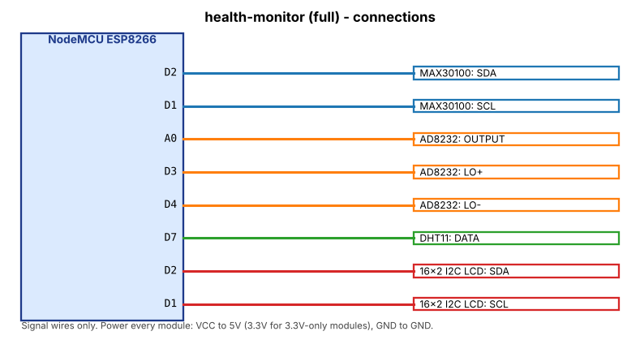
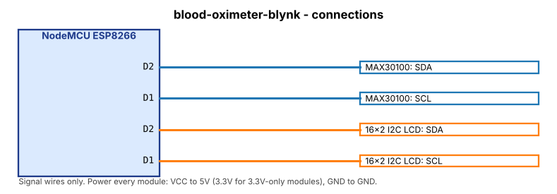

# Iot Health Monitor

> NodeMCU health monitor: heart rate, SpO2, ECG, temperature/humidity on LCD and Blynk.

**Board:** NodeMCU ESP8266

## Components required

- NodeMCU ESP8266
- MAX30100 pulse oximeter
- AD8232 ECG module with electrodes
- DHT11 temperature/humidity sensor
- 16x2 I2C LCD
- Blynk app (template *Health Monitoring*)

## Circuit / wiring

### health-monitor (full)

| Component | Component pin | Connect to (board pin) |
|---|---|---|
| MAX30100 | SDA | D2 |
| MAX30100 | SCL | D1 |
| AD8232 | OUTPUT | A0 |
| AD8232 | LO+ | D3 |
| AD8232 | LO- | D4 |
| DHT11 | DATA | D7 |
| 16x2 I2C LCD | GND | GND |
| 16x2 I2C LCD | VCC | Vin (5V) |
| 16x2 I2C LCD | SDA | D2 |
| 16x2 I2C LCD | SCL | D1 |

### blood-oximeter-blynk

| Component | Component pin | Connect to (board pin) |
|---|---|---|
| MAX30100 | SDA | D2 |
| MAX30100 | SCL | D1 |
| 16x2 I2C LCD | GND | GND |
| 16x2 I2C LCD | VCC | Vin (5V) |
| 16x2 I2C LCD | SDA | D2 |
| 16x2 I2C LCD | SCL | D1 |

_The pin numbers come straight from the `.ino` code. The connection charts are generated from the same pin list (not a Fritzing drawing). Double-check against your own hardware before powering on._

## Libraries needed

- `BlynkSimpleEsp8266.h`
- `DHT.h`
- `ESP8266WiFi.h`
- `LiquidCrystal_I2C.h`
- `LiquidCrystal_PCF8574.h`
- `MAX30100_PulseOximeter.h`
- `Wire.h`

## Code

- `health-monitor/health-monitor.ino`
- `blood-oximeter-blynk/blood-oximeter-blynk.ino`

## Working

1. The NodeMCU connects to Wi-Fi and Blynk.
2. MAX30100 gives **BPM** and **SpO2**; the AD8232 gives the **ECG** signal (checked for lead-off using LO+/LO-); DHT11 gives **temperature and humidity**.
3. In the full version the LCD shows BPM, SpO2, temperature and humidity, and the **ECG value is sent to Blynk V4**.
4. `blood-oximeter-blynk` is the simpler version: it sends **BPM to V0 and SpO2 to V1** and shows smiley icons for the SpO2 level.

## Notes

- For education only - this is not a medical device.
