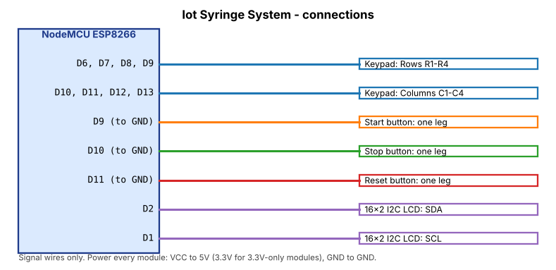

# Iot Syringe System

> Keypad and buttons set infusion parameters with Blynk connection. Motor logic is still a placeholder.

**Board:** NodeMCU ESP8266

## Components required

- NodeMCU ESP8266 (the code uses pin names D6-D13)
- 4x4 keypad
- 3 push buttons (Start, Stop, Reset)
- 16x2 I2C LCD
- Syringe pump motor + driver (to be added)
- Blynk app (template *IoT Syringe System*)

## Circuit / wiring

| Component | Component pin | Connect to (board pin) |
|---|---|---|
| Keypad | Rows R1-R4 | D6, D7, D8, D9 |
| Keypad | Columns C1-C4 | D10, D11, D12, D13 |
| Start button | one leg | D9 (to GND) |
| Stop button | one leg | D10 (to GND) |
| Reset button | one leg | D11 (to GND) |
| 16x2 I2C LCD | GND | GND |
| 16x2 I2C LCD | VCC | Vin (5V) |
| 16x2 I2C LCD | SDA | D2 |
| 16x2 I2C LCD | SCL | D1 |

_The pin numbers come straight from the `.ino` code. The connection charts are generated from the same pin list (not a Fritzing drawing). Double-check against your own hardware before powering on._

## Libraries needed

- `BlynkSimpleEsp8266.h`
- `Keypad.h`
- `LiquidCrystal_I2C.h`
- `Wire.h`

## Code

- `iot-syringe-system.ino`

## Working

1. The LCD shows *System Ready* and the device connects to Blynk.
2. The keypad is used to enter infusion parameters (the pressed key is shown on the LCD).
3. **Start button:** *Infusion Started*. **Stop button:** *Infusion Stopped*. **Reset button:** *System Reset* and parameters are cleared.

## Notes

- Status: work in progress. The motor start/stop code is still a placeholder (`Add logic for motor start/stop`).
- Pin conflict in the code: D9, D10, D11 are used both for keypad lines and for the buttons, and a NodeMCU has no D11-D13. Use a board with enough pins (Mega / ESP32) or an I2C keypad/expander, and update the pin numbers.
- Not a medical device.
