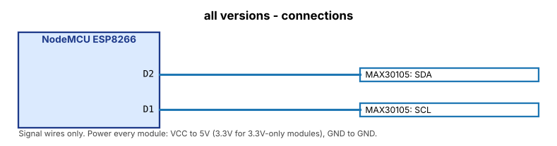
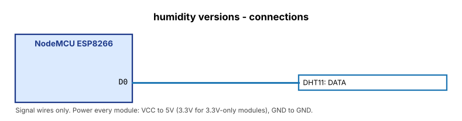
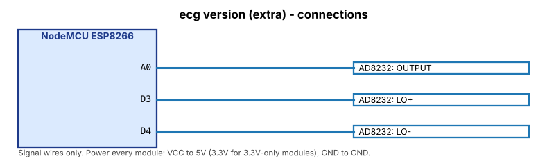

# Max30105 Heart Rate

> Heart-rate detection with MAX30105: serial, Blynk, humidity and ECG variants.

**Board:** NodeMCU ESP8266 (serial version also runs on Uno)

## Components required

- NodeMCU ESP8266
- MAX30105 particle/heart-rate sensor
- AD8232 ECG module (ECG version)
- DHT11 (humidity versions)
- Blynk app

## Circuit / wiring

### all versions

| Component | Component pin | Connect to (board pin) |
|---|---|---|
| MAX30105 | SDA | D2 |
| MAX30105 | SCL | D1 |
| MAX30105 | VIN | 3V3 |
| MAX30105 | GND | GND |

### humidity versions

| Component | Component pin | Connect to (board pin) |
|---|---|---|
| DHT11 | DATA | D0 |

### ecg version (extra)

| Component | Component pin | Connect to (board pin) |
|---|---|---|
| AD8232 | OUTPUT | A0 |
| AD8232 | LO+ | D3 |
| AD8232 | LO- | D4 |

_The pin numbers come straight from the `.ino` code. The connection charts are generated from the same pin list (not a Fritzing drawing). Double-check against your own hardware before powering on._

## Libraries needed

- `BlynkSimpleEsp8266.h`
- `DHT.h`
- `ESP8266WiFi.h`
- `MAX30105.h`
- `Wire.h`
- `heartRate.h`

## Code

- `max30105-serial/max30105-serial.ino`
- `max30105-blynk/max30105-blynk.ino`
- `max30105-blynk-humidity/max30105-blynk-humidity.ino`
- `max30105-ecg-humidity-blynk/max30105-ecg-humidity-blynk.ino`

## Working

1. The MAX30105 infrared reading is used to detect beats and compute an average **BPM** (average of the last 4 beats).
2. A reading above 50000 IR counts means a finger is present; otherwise BPM is set to 0.
3. Blynk datastreams: V0 = BPM, V1 = IR value, V2 = finger presence, V3 = humidity, V4 = ECG.
4. Versions: `max30105-serial` (Serial Monitor only), `max30105-blynk`, `max30105-blynk-humidity`, `max30105-ecg-humidity-blynk`.

## Notes

- Some versions send **placeholder values**: SpO2 is fixed at 98 in `max30105-blynk`, and humidity/temperature are random numbers (`random(30,70)`) in the humidity versions. Replace these with real sensor readings before using the data.
- For education only - this is not a medical device.
