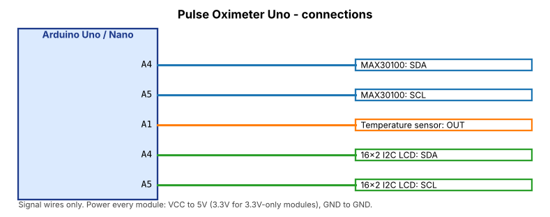

# Pulse Oximeter Uno

> MAX30100 heart rate and SpO2 shown on an LCD.

**Board:** Arduino Uno / Nano (same pin names)

## Components required

- Arduino Uno / Nano
- MAX30100 pulse oximeter sensor
- Temperature sensor (LM35 type)
- 16x2 I2C LCD

## Circuit / wiring

| Component | Component pin | Connect to (board pin) |
|---|---|---|
| MAX30100 | VIN | 3.3V |
| MAX30100 | GND | GND |
| MAX30100 | SDA | A4 |
| MAX30100 | SCL | A5 |
| Temperature sensor | OUT | A1 |
| 16x2 I2C LCD | GND | GND |
| 16x2 I2C LCD | VCC | 5V |
| 16x2 I2C LCD | SDA | A4 |
| 16x2 I2C LCD | SCL | A5 |

_The pin numbers come straight from the `.ino` code. The connection charts are generated from the same pin list (not a Fritzing drawing). Double-check against your own hardware before powering on._

## Libraries needed

- `LiquidCrystal_I2C.h`
- `MAX30100_PulseOximeter.h`
- `Wire.h`

## Code

- `pulse-oximeter-uno.ino`

## Working

1. The LCD shows *Health Monitor* at start-up.
2. Place a finger on the MAX30100. The library detects each heartbeat (*Beat!!!* on Serial).
3. Every second the LCD shows **BPM**, **SpO2 %** and the **temperature** read from A1.

## Notes

- For education only - this is not a medical device.
