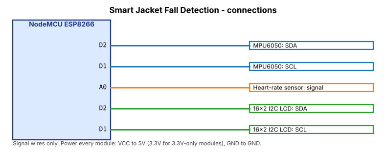

# Smart Jacket Fall Detection

> MPU6050 fall detection with heart rate and temperature sent to Blynk.

**Board:** NodeMCU ESP8266

## Components required

- NodeMCU ESP8266
- MPU6050 accelerometer + gyroscope
- Analog pulse/heart-rate sensor
- 16x2 I2C LCD
- Blynk app (template *Smart jacket*)

## Circuit / wiring

| Component | Component pin | Connect to (board pin) |
|---|---|---|
| MPU6050 | SDA | D2 |
| MPU6050 | SCL | D1 |
| MPU6050 | VCC | 3V3 |
| MPU6050 | GND | GND |
| Heart-rate sensor | signal | A0 |
| 16x2 I2C LCD | GND | GND |
| 16x2 I2C LCD | VCC | Vin (5V) |
| 16x2 I2C LCD | SDA | D2 |
| 16x2 I2C LCD | SCL | D1 |

_The pin numbers come straight from the `.ino` code. The connection charts are generated from the same pin list (not a Fritzing drawing). Double-check against your own hardware before powering on._

## Libraries needed

- `Adafruit_MPU6050.h`
- `Adafruit_Sensor.h`
- `BlynkSimpleEsp8266.h`
- `ESP8266WiFi.h`
- `LiquidCrystal_I2C.h`
- `Wire.h`

## Code

- `smart-jacket-fall-detection.ino`

## Working

1. The MPU6050 gives acceleration on X, Y and Z; the code computes the **acceleration magnitude**.
2. If the magnitude is **above 12**, a fall is detected and Blynk **V6** shows *Fall Detected!* (otherwise *No Fall*).
3. Every second the temperature (V0), X acceleration (V1), Y acceleration (V2) and heart-rate reading (V4) are sent to Blynk and shown on the LCD.

## Notes

- The heart rate value is the raw `analogRead(A0)` result, not a calibrated BPM.
