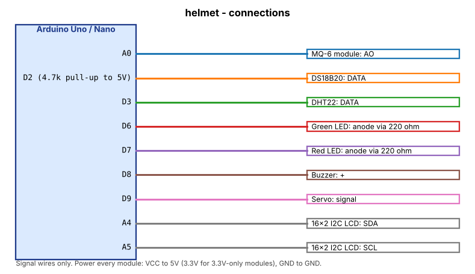
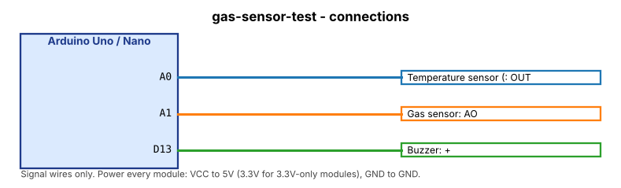

# Coal Mine Helmet

> Helmet monitors temperature, humidity and LPG gas; alarm and servo action on danger.

**Board:** Arduino Uno / Nano (same pin names)

## Components required

- Arduino Uno / Nano
- DS18B20 temperature sensor + 4.7k pull-up
- DHT22 humidity sensor
- MQ-6 gas sensor
- SG90 servo (valve/shutter)
- Buzzer, red LED, green LED
- 16x2 I2C LCD

## Circuit / wiring

### helmet

| Component | Component pin | Connect to (board pin) |
|---|---|---|
| MQ-6 module | AO | A0 |
| DS18B20 | DATA | D2 (4.7k pull-up to 5V) |
| DHT22 | DATA | D3 |
| Green LED | anode via 220 ohm | D6 |
| Red LED | anode via 220 ohm | D7 |
| Buzzer | + | D8 |
| Servo | signal | D9 |
| 16x2 I2C LCD | GND | GND |
| 16x2 I2C LCD | VCC | 5V |
| 16x2 I2C LCD | SDA | A4 |
| 16x2 I2C LCD | SCL | A5 |

### gas-sensor-test

| Component | Component pin | Connect to (board pin) |
|---|---|---|
| Temperature sensor (LM35) | OUT | A0 |
| Gas sensor | AO | A1 |
| Buzzer | + | D13 |

_The pin numbers come straight from the `.ino` code. The connection charts are generated from the same pin list (not a Fritzing drawing). Double-check against your own hardware before powering on._

## Libraries needed

- `DHT.h`
- `DallasTemperature.h`
- `LiquidCrystal_I2C.h`
- `OneWire.h`
- `Servo.h`
- `Wire.h`

## Code

- `helmet/helmet.ino`
- `gas-sensor-test/gas-sensor-test.ino`

## Working

1. The helmet reads gas (A0), temperature (DS18B20) and humidity (DHT22) and prints them on Serial.
2. Checks in order: **temperature >= 26 C** gives *High Temp Detected*; **humidity >= 60 %** gives *High Humidity Detected*; **gas value > 500** gives *LPG Detected*.
3. Any alarm turns OFF the green LED, turns ON the red LED and sounds the buzzer; for gas the servo also moves to 90 degrees and back.
4. If nothing is wrong, the LCD shows *No Alarm* and the green LED is ON.

## Notes

- Thresholds are demo values; set them for real mine conditions.
- A prototype only - not certified safety equipment.
