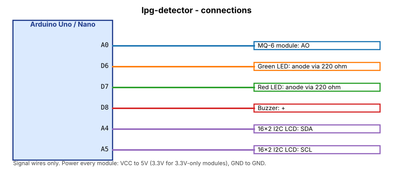
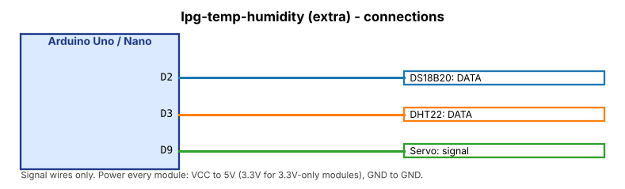
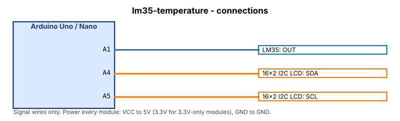

# Lpg Gas Detector

> MQ-6 LPG detection with LCD, buzzer and LEDs; variants with temperature/humidity.

**Board:** Arduino Uno / Nano (same pin names)

## Components required

- Arduino Uno / Nano
- MQ-6 LPG gas sensor
- Buzzer, red LED, green LED
- 16x2 I2C LCD
- Optional: DS18B20, DHT22, servo (temp-humidity version)

## Circuit / wiring

### lpg-detector

| Component | Component pin | Connect to (board pin) |
|---|---|---|
| MQ-6 module | AO | A0 |
| Green LED | anode via 220 ohm | D6 |
| Red LED | anode via 220 ohm | D7 |
| Buzzer | + | D8 |
| 16x2 I2C LCD | GND | GND |
| 16x2 I2C LCD | VCC | 5V |
| 16x2 I2C LCD | SDA | A4 |
| 16x2 I2C LCD | SCL | A5 |

### lpg-temp-humidity (extra)

| Component | Component pin | Connect to (board pin) |
|---|---|---|
| DS18B20 | DATA | D2 |
| DHT22 | DATA | D3 |
| Servo | signal | D9 |

### lm35-temperature

| Component | Component pin | Connect to (board pin) |
|---|---|---|
| LM35 | OUT | A1 |
| 16x2 I2C LCD | GND | GND |
| 16x2 I2C LCD | VCC | 5V |
| 16x2 I2C LCD | SDA | A4 |
| 16x2 I2C LCD | SCL | A5 |

_The pin numbers come straight from the `.ino` code. The connection charts are generated from the same pin list (not a Fritzing drawing). Double-check against your own hardware before powering on._

## Libraries needed

- `DHT.h`
- `DallasTemperature.h`
- `LiquidCrystal_I2C.h`
- `OneWire.h`
- `Servo.h`
- `Wire.h`

## Code

- `lpg-detector/lpg-detector.ino`
- `lpg-temp-humidity/lpg-temp-humidity.ino`
- `lm35-temperature/lm35-temperature.ino`

## Working

1. The MQ-6 value on A0 is printed on Serial.
2. **Above 300** (in `lpg-detector`): LCD shows *LPG Detected*, red LED and buzzer ON. Otherwise *LPG Not Detected* with the green LED ON.
3. `lpg-temp-humidity` adds temperature and humidity monitoring and moves a servo (for example to close a valve) when gas is found (threshold 500).
4. `lm35-temperature` simply shows the LM35 temperature on the LCD and Serial Monitor every second.

## Notes

- The fan/controller described in the temperature-monitoring report is not in `lm35-temperature` - it only displays temperature.
