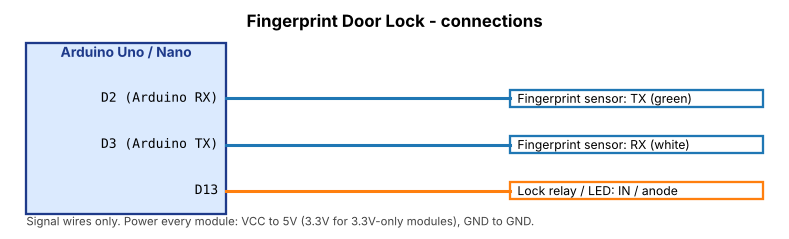

# Fingerprint Door Lock

> Fingerprint sensor based door lock.

**Board:** Arduino Uno / Nano (same pin names)

## Components required

- Arduino Uno / Nano
- R307 / Adafruit-compatible fingerprint sensor
- Relay / LED on D13 (lock indicator)

## Circuit / wiring

| Component | Component pin | Connect to (board pin) |
|---|---|---|
| Fingerprint sensor | TX (green) | D2 (Arduino RX) |
| Fingerprint sensor | RX (white) | D3 (Arduino TX) |
| Fingerprint sensor | VCC | 5V |
| Fingerprint sensor | GND | GND |
| Lock relay / LED | IN / anode | D13 |

_The pin numbers come straight from the `.ino` code. The connection charts are generated from the same pin list (not a Fritzing drawing). Double-check against your own hardware before powering on._

## Libraries needed

- `Adafruit_Fingerprint.h`
- `SoftwareSerial.h`

## Code

- `fingerprint-door-lock.ino`

## Working

1. The Adafruit fingerprint library checks the sensor at start-up.
2. Place a finger. If it matches a stored fingerprint, D13 is driven HIGH to unlock (LED or relay), then returns LOW.
3. If the finger is not found, the Serial Monitor prints *Finger not found* and D13 stays LOW.

## Notes

- Enrol fingerprints first with the Adafruit `enroll` example.
