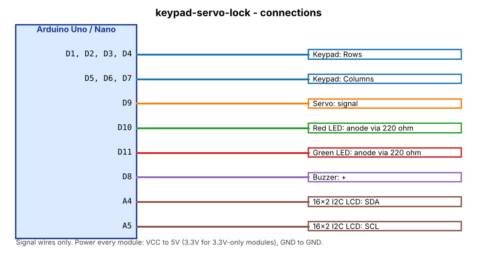
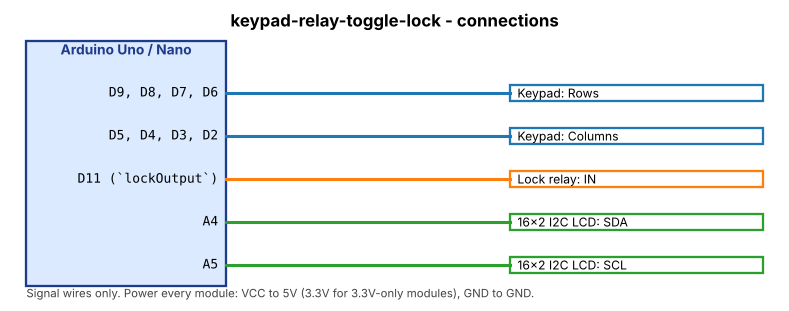

# Keypad Door Lock

> Password door lock with keypad, LCD, servo (or relay) and lock-out after wrong code.

**Board:** Arduino Uno / Nano (same pin names)

## Components required

- Arduino Uno / Nano
- 4x3 keypad (servo version) or 4x4 keypad (relay version)
- SG90 servo (door latch) or relay + electric lock
- 16x2 I2C LCD
- Buzzer, red LED, green LED

## Circuit / wiring

### keypad-servo-lock

| Component | Component pin | Connect to (board pin) |
|---|---|---|
| Keypad | Rows | D1, D2, D3, D4 |
| Keypad | Columns | D5, D6, D7 |
| Servo | signal | D9 |
| Red LED | anode via 220 ohm | D10 |
| Green LED | anode via 220 ohm | D11 |
| Buzzer | + | D8 |
| 16x2 I2C LCD | GND | GND |
| 16x2 I2C LCD | VCC | 5V |
| 16x2 I2C LCD | SDA | A4 |
| 16x2 I2C LCD | SCL | A5 |

### keypad-relay-toggle-lock

| Component | Component pin | Connect to (board pin) |
|---|---|---|
| Keypad | Rows | D9, D8, D7, D6 |
| Keypad | Columns | D5, D4, D3, D2 |
| Lock relay | IN | D11 (`lockOutput`) |
| 16x2 I2C LCD | GND | GND |
| 16x2 I2C LCD | VCC | 5V |
| 16x2 I2C LCD | SDA | A4 |
| 16x2 I2C LCD | SCL | A5 |

_The pin numbers come straight from the `.ino` code. The connection charts are generated from the same pin list (not a Fritzing drawing). Double-check against your own hardware before powering on._

## Libraries needed

- `Keypad.h`
- `LiquidCrystal_I2C.h`
- `Servo.h`
- `Wire.h`

## Code

- `keypad-servo-lock/keypad-servo-lock.ino`
- `keypad-relay-toggle-lock/keypad-relay-toggle-lock.ino`

## Working

**Servo version**
1. The LCD asks for the **PASSWORD** and shows `*` for each key.
2. Correct code: *Access Granted*, servo unlocks, green LED ON. After a countdown (5-4-3-2-1) it shows *RE-LOCKING* and locks again.
3. Wrong code: *INCORRECT*, red LED and buzzer ON, and the keypad is locked for **15 seconds**.

**Relay toggle version:** a correct 4-digit password toggles the lock relay ON/OFF.

## Notes

- The servo version uses D1 (TX) for the keypad, which clashes with the Serial Monitor. Use other pins if you want serial debugging.
- Change the default demo password before real use.
