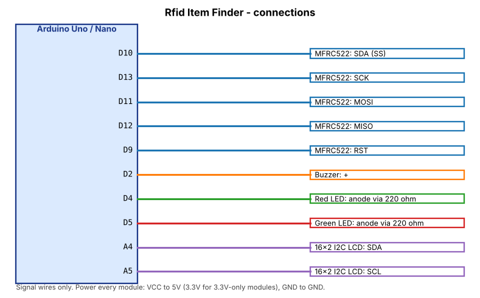

# Rfid Item Finder

> RFID tags on items identified and displayed on an LCD with LED/buzzer.

**Board:** Arduino Uno / Nano (same pin names)

## Components required

- Arduino Uno / Nano
- MFRC522 RFID reader
- RFID tags on items (pocket, keys)
- Green LED, red LED, buzzer
- 16x2 I2C LCD

## Circuit / wiring

| Component | Component pin | Connect to (board pin) |
|---|---|---|
| MFRC522 | SDA (SS) | D10 |
| MFRC522 | SCK | D13 |
| MFRC522 | MOSI | D11 |
| MFRC522 | MISO | D12 |
| MFRC522 | RST | D9 |
| MFRC522 | 3.3V | 3.3V |
| Buzzer | + | D2 |
| Red LED | anode via 220 ohm | D4 |
| Green LED | anode via 220 ohm | D5 |
| 16x2 I2C LCD | GND | GND |
| 16x2 I2C LCD | VCC | 5V |
| 16x2 I2C LCD | SDA | A4 |
| 16x2 I2C LCD | SCL | A5 |

_The pin numbers come straight from the `.ino` code. The connection charts are generated from the same pin list (not a Fritzing drawing). Double-check against your own hardware before powering on._

## Libraries needed

- `LiquidCrystal_I2C.h`
- `MFRC522.h`
- `SPI.h`
- `Wire.h`

## Code

- `rfid-item-finder.ino`

## Working

1. The LCD shows *locating...* while it waits for a tag.
2. When a tag is scanned the UID is read and compared with the stored UIDs.
3. A known UID shows which item was found (*Pocket found*, *keys found*) with the green LED and a beep. Unknown tags use the red LED.

## Notes

- The folder name says *attendance* in the original code but it works as an item finder; replace the UIDs with yours.
