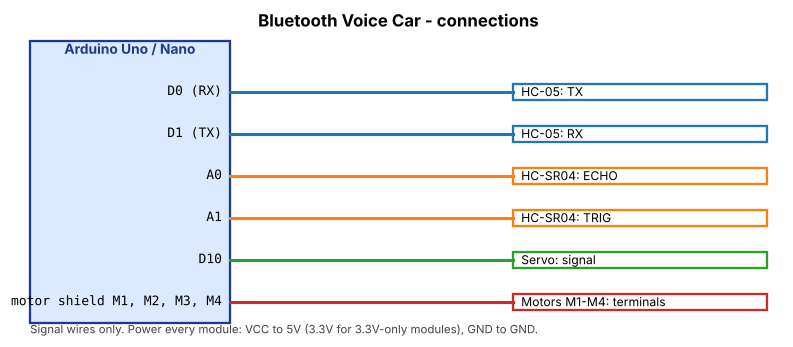

# Bluetooth Voice Car

> 4-motor car driven by Bluetooth app or voice, with ultrasonic obstacle avoidance.

**Board:** Arduino Uno / Nano (same pin names) + Adafruit L293D motor shield

## Components required

- Arduino Uno
- Adafruit L293D motor shield
- 4 DC motors + chassis
- HC-05 Bluetooth module
- HC-SR04 ultrasonic sensor
- SG90 servo (scanner)
- Android app (Bluetooth RC / voice control)

## Circuit / wiring

| Component | Component pin | Connect to (board pin) |
|---|---|---|
| HC-05 | TX | D0 (RX) |
| HC-05 | RX | D1 (TX) |
| HC-SR04 | ECHO | A0 |
| HC-SR04 | TRIG | A1 |
| Servo | signal | D10 |
| Motors M1-M4 | terminals | motor shield M1, M2, M3, M4 |

_The pin numbers come straight from the `.ino` code. The connection charts are generated from the same pin list (not a Fritzing drawing). Double-check against your own hardware before powering on._

## Libraries needed

- `AFMotor.h`
- `Servo.h`

## Code

- `bluetooth-voice-car.ino`

## Working

1. Pair the phone with the HC-05. The app sends single-character commands: **F** forward, **B** back, **L** left, **R** right, **S** stop. Voice commands are sent the same way.
2. The speed is set to 170 (of 255).
3. **Obstacle avoidance:** if the ultrasonic sensor sees an object within 12 cm, the car stops, the servo scans left and right, and the car turns toward the side with more space.

## Notes

- Disconnect HC-05 TX/RX while uploading code (hardware serial).
- Needs the `AFMotor` library.
