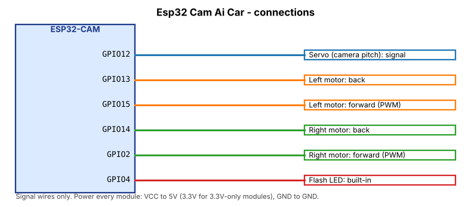

# Esp32 Cam Ai Car

> ESP32-CAM streams video over WebSockets and takes drive/servo commands over UDP. Based on open-source code - add original credit and licence.

**Board:** ESP32-CAM (AI-Thinker)

## Components required

- ESP32-CAM board
- DC motors + motor driver
- SG90 servo (camera tilt)
- Battery pack
- PC/phone app that receives the video and sends commands

## Circuit / wiring

| Component | Component pin | Connect to (board pin) |
|---|---|---|
| Servo (camera pitch) | signal | GPIO12 |
| Left motor | back | GPIO13 |
| Left motor | forward (PWM) | GPIO15 |
| Right motor | back | GPIO14 |
| Right motor | forward (PWM) | GPIO2 |
| Flash LED | built-in | GPIO4 |

_The pin numbers come straight from the `.ino` code. The connection charts are generated from the same pin list (not a Fritzing drawing). Double-check against your own hardware before powering on._

## Libraries needed

- `WebSocketsServer.h`
- `WiFi.h`
- `WiFiUdp.h`
- `vector`

## Code

- `esp32-cam-ai-car.ino`

## Working

1. The ESP32-CAM joins your Wi-Fi (station mode) and streams JPEG frames over a **WebSocket (port 86)**.
2. A controlling app on a PC or phone receives the video, runs the vision/AI logic, and sends motor and servo commands as UDP packets to **port 6868**.
3. The ESP32 parses the packet and drives the left and right motors (PWM) and the camera tilt servo.

## Notes

- Based on open-source ESP32-CAM AI-car code. Add the original author, link and licence here before publishing.
