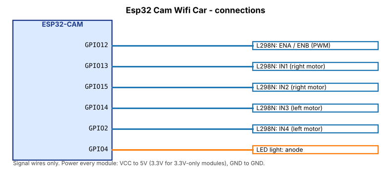

# Esp32 Cam Wifi Car

> ESP32-CAM web page with live video and on-screen car controls.

**Board:** ESP32-CAM (AI-Thinker)

## Components required

- ESP32-CAM board + FTDI programmer
- L298N motor driver + 2 DC motors
- LED light (flash pin)
- Battery pack (7-12 V) and 5 V supply for the ESP32

## Circuit / wiring

| Component | Component pin | Connect to (board pin) |
|---|---|---|
| L298N | ENA / ENB (PWM) | GPIO12 |
| L298N | IN1 (right motor) | GPIO13 |
| L298N | IN2 (right motor) | GPIO15 |
| L298N | IN3 (left motor) | GPIO14 |
| L298N | IN4 (left motor) | GPIO2 |
| LED light | anode | GPIO4 |

_The pin numbers come straight from the `.ino` code. The connection charts are generated from the same pin list (not a Fritzing drawing). Double-check against your own hardware before powering on._

## Libraries needed

- `Arduino.h`
- `AsyncTCP.h`
- `ESPAsyncWebServer.h`
- `WiFi.h`
- `esp_camera.h`
- `iostream`
- `sstream`

## Code

- `esp32-cam-wifi-car.ino`

## Working

1. The ESP32-CAM joins your Wi-Fi and prints its IP address.
2. Open that IP in a browser: it shows a **live camera stream** with arrow buttons, a speed slider and a light switch.
3. Button presses go to the ESP32 through a WebSocket; the code sets the L298N pins to move forward, back, left or right.
4. GPIO4 controls the light with PWM.

## Notes

- Needs the `AsyncTCP` and `ESPAsyncWebServer` libraries and the board package *ESP32 by Espressif*. Put GPIO0 to GND to upload, then remove it.
- Based on a common ESP32-CAM car pattern. Add credit if you used a tutorial.
