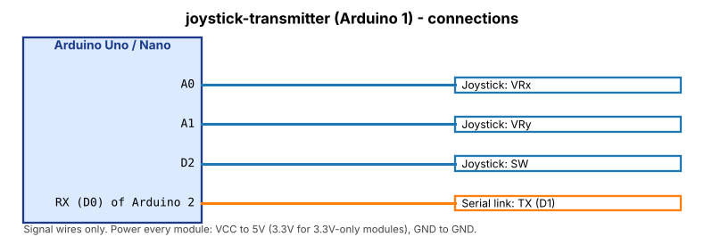
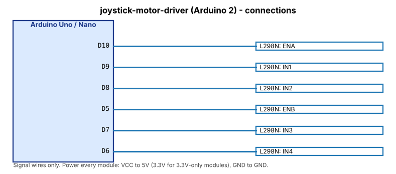

# Joystick Car

> Joystick Arduino sends motor speeds over serial to a second Arduino driving the motors.

**Board:** Arduino Uno / Nano (same pin names) (two boards)

## Components required

- 2 x Arduino Uno / Nano
- Joystick module
- L298N motor driver + 2 DC motors
- Battery pack

## Circuit / wiring

### joystick-transmitter (Arduino 1)

| Component | Component pin | Connect to (board pin) |
|---|---|---|
| Joystick | VRx | A0 |
| Joystick | VRy | A1 |
| Joystick | SW | D2 |
| Serial link | TX (D1) | RX (D0) of Arduino 2 |
| Serial link | GND | GND of Arduino 2 |

### joystick-motor-driver (Arduino 2)

| Component | Component pin | Connect to (board pin) |
|---|---|---|
| L298N | ENA | D10 |
| L298N | IN1 | D9 |
| L298N | IN2 | D8 |
| L298N | ENB | D5 |
| L298N | IN3 | D7 |
| L298N | IN4 | D6 |

_The pin numbers come straight from the `.ino` code. The connection charts are generated from the same pin list (not a Fritzing drawing). Double-check against your own hardware before powering on._

## Libraries needed

- None (built-in only)

## Code

- `joystick-transmitter/joystick-transmitter.ino`
- `joystick-motor-driver/joystick-motor-driver.ino`

## Working

1. Arduino 1 reads the joystick X/Y and maps them to left and right motor speeds.
2. It sends the two speeds over serial as text (`left,right`).
3. Arduino 2 reads the string, splits it, and drives motor A and B through the L298N (direction pins and PWM).
4. Pushing the stick forward, back, left or right drives the car in that direction.

## Notes

- Disconnect the serial wires while uploading code.
