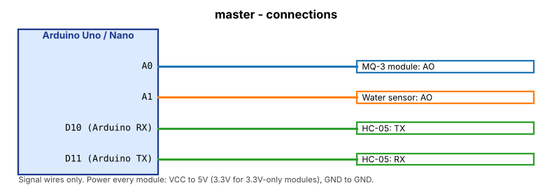
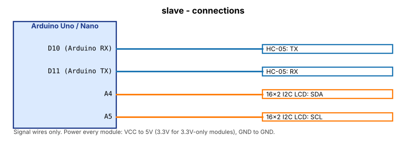

# Bluetooth Master Slave

> Master Arduino sends alcohol and water sensor values over HC-05; slave shows them on LCD.

**Board:** Arduino Uno / Nano (same pin names) (two boards)

## Components required

- 2 x Arduino Uno / Nano
- 2 x HC-05 (one master, one slave)
- MQ-3 alcohol sensor
- Water level / rain sensor
- 16x2 I2C LCD

## Circuit / wiring

### master

| Component | Component pin | Connect to (board pin) |
|---|---|---|
| MQ-3 module | AO | A0 |
| Water sensor | AO | A1 |
| HC-05 | TX | D10 (Arduino RX) |
| HC-05 | RX | D11 (Arduino TX) |

### slave

| Component | Component pin | Connect to (board pin) |
|---|---|---|
| HC-05 | TX | D10 (Arduino RX) |
| HC-05 | RX | D11 (Arduino TX) |
| 16x2 I2C LCD | GND | GND |
| 16x2 I2C LCD | VCC | 5V |
| 16x2 I2C LCD | SDA | A4 |
| 16x2 I2C LCD | SCL | A5 |

_The pin numbers come straight from the `.ino` code. The connection charts are generated from the same pin list (not a Fritzing drawing). Double-check against your own hardware before powering on._

## Libraries needed

- `LiquidCrystal_I2C.h`
- `SoftwareSerial.h`
- `Wire.h`

## Code

- `master/master.ino`
- `slave/slave.ino`

## Working

1. The master Arduino reads the alcohol (A0) and water (A1) sensors every cycle.
2. It sends the two values over Bluetooth as `alcohol,water`.
3. The slave receives the text, splits it at the comma, and shows *Alcohol: xxx* and *Water: xxx* on the LCD.

## Notes

- Pair the two HC-05 modules first (AT commands) so they connect automatically.
