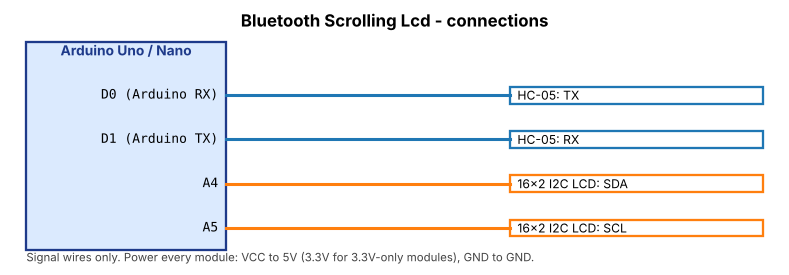

# Bluetooth Scrolling Lcd

> Text typed in a Bluetooth app scrolls on a 16x2 LCD.

**Board:** Arduino Uno / Nano (same pin names)

## Components required

- Arduino Uno / Nano
- HC-05 Bluetooth module
- 16x2 I2C LCD
- Android Bluetooth terminal app

## Circuit / wiring

| Component | Component pin | Connect to (board pin) |
|---|---|---|
| HC-05 | TX | D0 (Arduino RX) |
| HC-05 | RX | D1 (Arduino TX) |
| 16x2 I2C LCD | GND | GND |
| 16x2 I2C LCD | VCC | 5V |
| 16x2 I2C LCD | SDA | A4 |
| 16x2 I2C LCD | SCL | A5 |

_The pin numbers come straight from the `.ino` code. The connection charts are generated from the same pin list (not a Fritzing drawing). Double-check against your own hardware before powering on._

## Libraries needed

- `LiquidCrystal_I2C.h`
- `Wire.h`

## Code

- `bluetooth-scrolling-lcd.ino`

## Working

1. The LCD first shows *Welcome to Notice Board*.
2. Send text from the phone over Bluetooth. Every received character is added to a 16-character buffer.
3. The text scrolls across the first line of the LCD, one character at a time (100 ms per step).

## Notes

- Disconnect HC-05 TX while uploading code.
