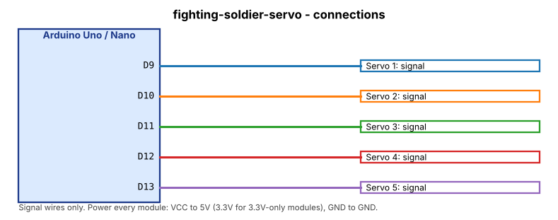
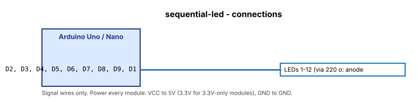
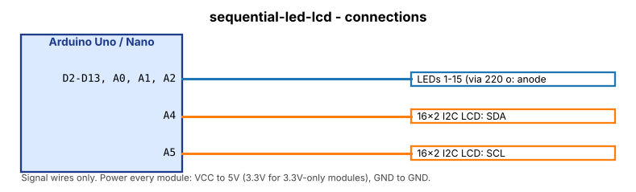

# Shiv Jayanti Demos

> Event demos: servo fighting-soldier model and sequential LED effects.

**Board:** Arduino Uno / Nano (same pin names)

## Components required

- Arduino Uno / Nano
- 5 x SG90 servo (soldier model)
- 12-15 LEDs + resistors
- 16x2 I2C LCD (LCD version)

## Circuit / wiring

### fighting-soldier-servo

| Component | Component pin | Connect to (board pin) |
|---|---|---|
| Servo 1 | signal | D9 |
| Servo 2 | signal | D10 |
| Servo 3 | signal | D11 |
| Servo 4 | signal | D12 |
| Servo 5 | signal | D13 |

### sequential-led

| Component | Component pin | Connect to (board pin) |
|---|---|---|
| LEDs 1-12 (via 220 ohm) | anode | D2, D3, D4, D5, D6, D7, D8, D9, D10, D11, D12, D13 |

### sequential-led-lcd

| Component | Component pin | Connect to (board pin) |
|---|---|---|
| LEDs 1-15 (via 220 ohm) | anode | D2-D13, A0, A1, A2 |
| 16x2 I2C LCD | GND | GND |
| 16x2 I2C LCD | VCC | 5V |
| 16x2 I2C LCD | SDA | A4 |
| 16x2 I2C LCD | SCL | A5 |

_The pin numbers come straight from the `.ino` code. The connection charts are generated from the same pin list (not a Fritzing drawing). Double-check against your own hardware before powering on._

## Libraries needed

- `LiquidCrystal_I2C.h`
- `Servo.h`
- `Wire.h`

## Code

- `fighting-soldier-servo/fighting-soldier-servo.ino`
- `sequential-led/sequential-led.ino`
- `sequential-led-lcd/sequential-led-lcd.ino`

## Working

**fighting-soldier-servo:** five servos sweep together (some at double angle) to make the soldier figure swing sword and arm - a moving display for the Shiv Jayanti exhibit.

**sequential-led:** LEDs light one after another in sequence and then switch off together, for decoration.

**sequential-led-lcd:** the same LED pattern with a message on the LCD.

## Demo video / photos

_Add a YouTube or Google Drive link here, and photos of the finished project._

## Notes

- Power the five servos from an external 5 V supply, not from the Arduino pin.
