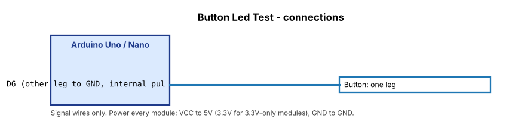

# Button Led Test

> Button press turns an LED/light on.

**Board:** Arduino Uno / Nano (same pin names)

## Components required

- Board + the component named in the pin table

## Circuit / wiring

| Component | Component pin | Connect to (board pin) |
|---|---|---|
| Button | one leg | D6 (other leg to GND, internal pull-up) |

_The pin numbers come straight from the `.ino` code. The connection charts are generated from the same pin list (not a Fritzing drawing). Double-check against your own hardware before powering on._

## Libraries needed

- None (built-in only)

## Code

- `button-led-test.ino`

## Working

Pressing the button turns the light/LED on D7 ON for 100 ms.

