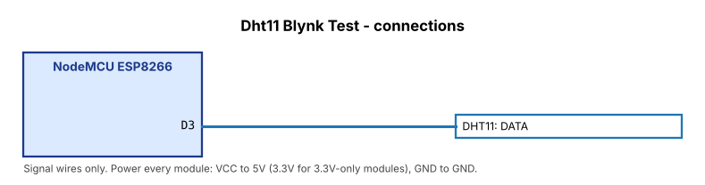

# Dht11 Blynk Test

> DHT11 temperature and humidity sent to Blynk.

**Board:** NodeMCU ESP8266

## Components required

- Board + the component named in the pin table

## Circuit / wiring

| Component | Component pin | Connect to (board pin) |
|---|---|---|
| DHT11 | DATA | D3 |

_The pin numbers come straight from the `.ino` code. The connection charts are generated from the same pin list (not a Fritzing drawing). Double-check against your own hardware before powering on._

## Libraries needed

- `BlynkSimpleEsp8266.h`
- `DHT.h`
- `ESP8266WiFi.h`

## Code

- `dht11-blynk-test.ino`

## Working

Reads DHT11 temperature and humidity every second and sends them to Blynk virtual pins.

