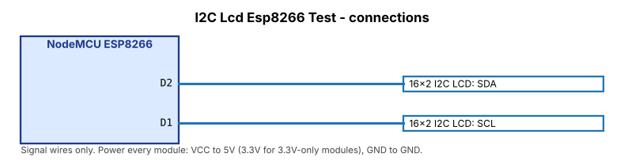

# I2C Lcd Esp8266 Test

> Hello-world test for an I2C LCD on ESP8266.

**Board:** NodeMCU ESP8266

## Components required

- Board + the component named in the pin table

## Circuit / wiring

| Component | Component pin | Connect to (board pin) |
|---|---|---|
| 16x2 I2C LCD | GND | GND |
| 16x2 I2C LCD | VCC | Vin (5V) |
| 16x2 I2C LCD | SDA | D2 |
| 16x2 I2C LCD | SCL | D1 |

_The pin numbers come straight from the `.ino` code. The connection charts are generated from the same pin list (not a Fritzing drawing). Double-check against your own hardware before powering on._

## Libraries needed

- `LiquidCrystal_PCF8574.h`
- `Wire.h`

## Code

- `i2c-lcd-esp8266-test.ino`

## Working

Prints Hello World on a PCF8574 I2C LCD to confirm wiring and address.

## Demo video / photos

_Add a YouTube or Google Drive link here, and photos of the finished project._
