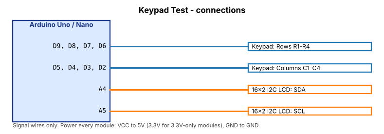

# Keypad Test

> 4x4 keypad test with LCD output.

**Board:** Arduino Uno / Nano (same pin names)

## Components required

- Board + the component named in the pin table

## Circuit / wiring

| Component | Component pin | Connect to (board pin) |
|---|---|---|
| Keypad | Rows R1-R4 | D9, D8, D7, D6 |
| Keypad | Columns C1-C4 | D5, D4, D3, D2 |
| 16x2 I2C LCD | GND | GND |
| 16x2 I2C LCD | VCC | 5V |
| 16x2 I2C LCD | SDA | A4 |
| 16x2 I2C LCD | SCL | A5 |

_The pin numbers come straight from the `.ino` code. The connection charts are generated from the same pin list (not a Fritzing drawing). Double-check against your own hardware before powering on._

## Libraries needed

- `Keypad.h`
- `LiquidCrystal_I2C.h`

## Code

- `keypad-test.ino`

## Working

Shows the pressed key of a 4x4 keypad on the LCD.

## Demo video / photos

_Add a YouTube or Google Drive link here, and photos of the finished project._
