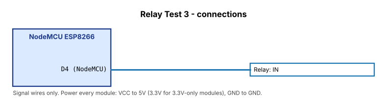

# Relay Test 3

> Toggles a relay every second.

**Board:** NodeMCU ESP8266

## Components required

- Board + the component named in the pin table

## Circuit / wiring

| Component | Component pin | Connect to (board pin) |
|---|---|---|
| Relay | IN | D4 (NodeMCU) |

_The pin numbers come straight from the `.ino` code. The connection charts are generated from the same pin list (not a Fritzing drawing). Double-check against your own hardware before powering on._

## Libraries needed

- None (built-in only)

## Code

- `relay-test-3.ino`

## Working

Toggles the relay every second and prints *Relay 3: ON/OFF* on Serial. Use it to check wiring before building automation projects.

## Demo video / photos

_Add a YouTube or Google Drive link here, and photos of the finished project._
