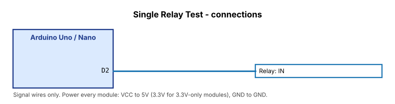

# Single Relay Test

> Relay on/off from serial commands.

**Board:** Arduino Uno / Nano (same pin names)

## Components required

- Board + the component named in the pin table

## Circuit / wiring

| Component | Component pin | Connect to (board pin) |
|---|---|---|
| Relay | IN | D2 |

_The pin numbers come straight from the `.ino` code. The connection charts are generated from the same pin list (not a Fritzing drawing). Double-check against your own hardware before powering on._

## Libraries needed

- None (built-in only)

## Code

- `single-relay-test.ino`

## Working

Send **ON** / **OFF** over the Serial Monitor to switch the relay.

## Demo video / photos

_Add a YouTube or Google Drive link here, and photos of the finished project._
